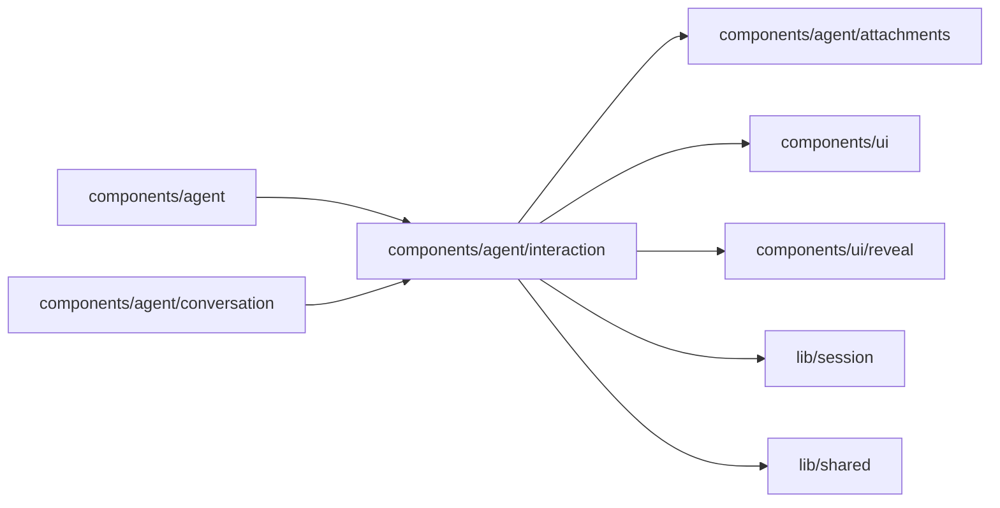

# Agent interaction

<!-- BEGIN GENERATED DIRECTORY SUMMARY (scripts/check-readmes.mjs; edit only Purpose) -->
Purpose: What the Agent asks of and shows the reader: question batches, an old waiting requirements card, each recorded version's line, queued messages, todo progress, timers and background tasks.

Importers: `components/agent` and `components/agent/conversation` import this directory.

Imports: it imports `components/agent/attachments`, `components/ui`, `components/ui/reveal`, `lib/session` and `lib/shared`.

<!-- END GENERATED DIRECTORY SUMMARY -->
