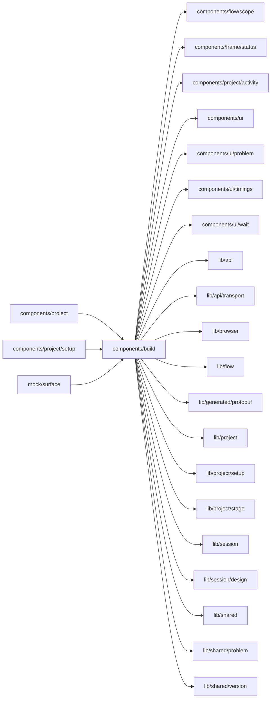

# Build surface

<!-- BEGIN GENERATED DIRECTORY SUMMARY (scripts/check-readmes.mjs; edit only Purpose) -->
Purpose: The Flow and Interface surfaces: the Flow Definitions of the version shown, the Preview with its source, Start and Stop, problem, phases and history, and the automatic-builds switch.

Importers: `components/project`, `components/project/setup` and `mock/surface` import this directory.

Imports: it imports `components/flow/scope`, `components/frame/status`, `components/project/activity`, `components/ui`, `components/ui/problem`, `components/ui/timings`, `components/ui/wait`, `lib/api`, `lib/api/transport`, `lib/browser`, `lib/flow`, `lib/generated/protobuf`, `lib/project`, `lib/project/setup`, `lib/project/stage`, `lib/session`, `lib/session/design`, `lib/shared`, `lib/shared/problem` and `lib/shared/version`.

<!-- END GENERATED DIRECTORY SUMMARY -->
