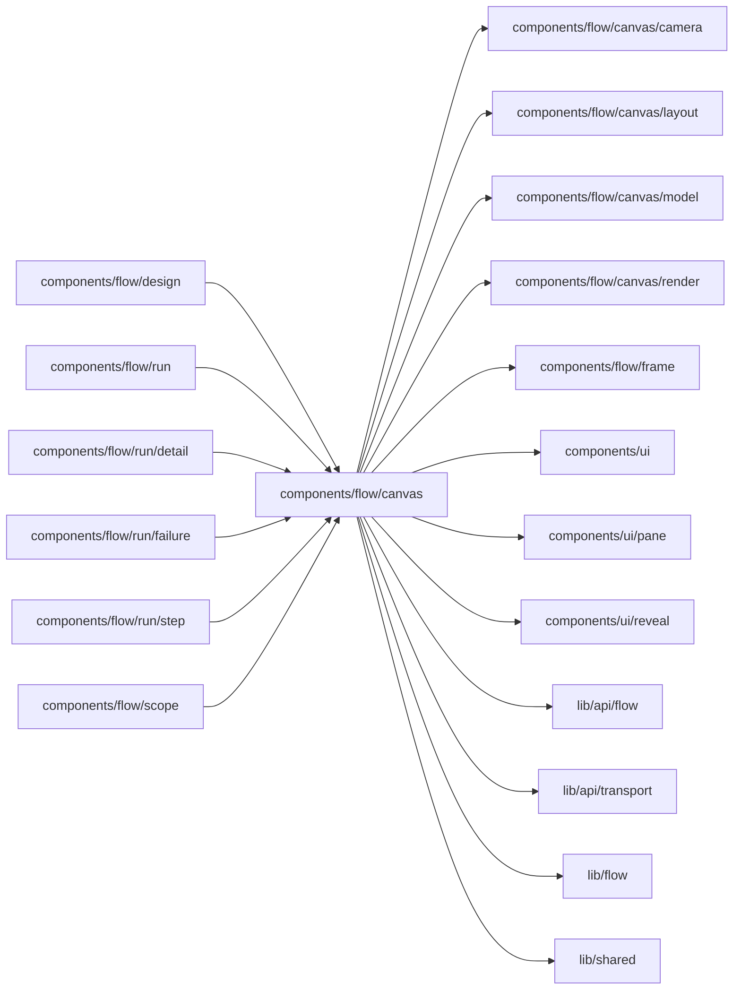

# Flow canvas

<!-- BEGIN GENERATED DIRECTORY SUMMARY (scripts/check-readmes.mjs; edit only Purpose) -->
Purpose: Draws a Flow Definition on a React Flow canvas, by stage or by Step, with its controls, legend and Step panel, optionally overlaid with one run and its failure.

Importers: `components/flow/design`, `components/flow/run`, `components/flow/run/detail`, `components/flow/run/failure`, `components/flow/run/step` and `components/flow/scope` import this directory.

Imports: it imports `components/flow/canvas/camera`, `components/flow/canvas/layout`, `components/flow/canvas/model`, `components/flow/canvas/render`, `components/flow/frame`, `components/ui`, `components/ui/pane`, `components/ui/reveal`, `lib/api/flow`, `lib/api/transport`, `lib/flow` and `lib/shared`.

<!-- END GENERATED DIRECTORY SUMMARY -->

`FlowGraphCanvas` draws optional text marks above Step cards, **new** or **changed**,
which a closed stage carries for its Steps: a design's against the current source, and,
through `FlowCanvas`'s `changes`, the Steps a new build added or changed against the one
before it, which its host passes for a moment. A new build's marks pulse softly
(`motion-safe`), so they stay still for a reader who prefers reduced motion.
