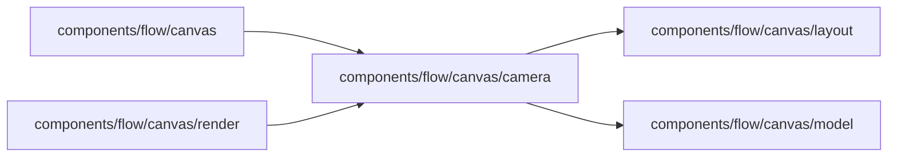

# Canvas camera

<!-- BEGIN GENERATED DIRECTORY SUMMARY (scripts/check-readmes.mjs; edit only Purpose) -->
Purpose: Frames what the canvas shows: a Step with the Steps around it, legibly; the entrance trace of a new drawing; one eased move per change.

Importers: `components/flow/canvas` and `components/flow/canvas/render` import this directory.

Imports: it imports `components/flow/canvas/layout` and `components/flow/canvas/model`.

<!-- END GENERATED DIRECTORY SUMMARY -->

The camera decides what the canvas shows and how it gets there; `render/Stage.tsx` applies it. Its
rules are plain geometry in `camera.ts`, and `use-camera.ts` decides when they run.

## Framing a Step

A focused Step, or the Step a shown run is at, is framed by these rules, in order:

1. Its card and the card of every Step a transition joins to it, in or out, are in view, whether the
   transition is drawn as a line or docked as a ↪ chip. A Step inside a closed stage counts as the stage.
2. Never past the cards' drawn size (100%): the point is to read the Step, not to magnify it.
3. Never below the readable zoom (74%, titles of 10px). When the joined Steps cannot all fit there, the
   nearest ones that do stay in view with the Step.
4. More context while it is cheap: the whole Flow, else the Steps two transitions away, while the Step
   keeps at least 80% of the size the joined Steps alone allow. A small Flow therefore shows whole, and
   picking another of its runs does not move the view.
5. The room is the pane less its margins and the Step panel that overlays it; a drawer beside the
   canvas narrows the pane before the frame is chosen.

## Motion

- **Entrance.** Nothing is drawn until the layout and the shown run have loaded and the stage holding
  the run's Step is open, so the canvas never flies in from React Flow's default view or shows a
  half-way drawing. It then opens framed and traces in from its start, like the running Dex mark: each
  card swells into place as the trace reaches it along the lines, each line draws out of the card it
  leaves, and the run's "now" ring lands last. The whole trace takes under half a second.
- **One move per change.** Another run of the same Process, Collapsed, Expanded or a new direction moves
  the cards and the view together, once, on one eased curve (`--ease-glide`). While the next run loads,
  the last one stays on screen, dimmed, instead of passing through intermediate layouts.
- **Live runs.** A poll never refits the view. When the run moves on, a head with a fading trail travels
  the line to its next Step, whose ring then lands; the camera follows only while the view is still its
  own framing, and otherwise pans just enough to show the Step.
- **The reader's view.** Once the reader pans, zooms or follows a chip, the view is theirs: a resize keeps
  their place and only keeps their selection in view. Fit hands the view back to the whole Flow.
- **Where the run is, and the overall view.** Picking a run frames its Step. Picking the open run again
  does it once more: the reader's selection goes and the stage holding the Step opens again. Collapsed,
  Expanded and a new direction release that framing and return to the opening view (the whole Flow when
  it reads, else its start) until the run is picked again; the Step stays ringed "now".
- **Reduced motion.** With `prefers-reduced-motion`, every change is instant and nothing traces or travels.
