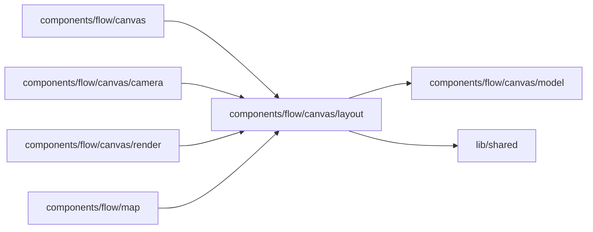

# Canvas layout

<!-- BEGIN GENERATED DIRECTORY SUMMARY (scripts/check-readmes.mjs; edit only Purpose) -->
Purpose: Places a decoded Flow into one Scene: stages or Steps, the main lines drawn and the jumps docked as chips, ELK placement and group bands.

Importers: `components/flow/canvas`, `components/flow/canvas/camera`, `components/flow/canvas/render` and `components/flow/map` import this directory.

Imports: it imports `components/flow/canvas/model` and `lib/shared`.

<!-- END GENERATED DIRECTORY SUMMARY -->

## The rules a drawing follows

In priority order; a lower rule never breaks a higher one, and ties go to shorter lines, fewer bends,
then reading order.

Never broken:

1. Nothing is lost. Every Step of the main story and every ordinary transition appears, as a line or as
   a ↪ chip on the Step it leaves. Failure handling is left out until it is asked for, and counted by
   ⚠ on each Step card a failure leaves (see Failure handling below). A wait the analyser could not
   name is drawn as a wait, never as automatic.
2. No line passes under a card, and two lines never share a track (ELK's orthogonal routing).
3. The start comes first in the reading direction and is on screen when the canvas opens.
4. Status is never colour alone: every state has words or a glyph.
5. Layout never blanks the canvas: each failed ELK pass falls back to a simpler one, the last to a plain
   grid, and the legend says so.

Primary goals:

6. The main path reads straight along the reading direction.
7. A Step sits after every Step that leads to it (`longestPathRanks`), so shared finish and error
   Steps land at the end, not beside an early exit.
8. Fewest crossings.
9. One line in (`mainLines`): each Step is drawn with its main line, the transition from the latest
   Step that leads to it, from its own stage when one does, and every other transition is a ↪ chip on
   the Step it leaves. The main lines are chosen once between Steps and every view draws the ones that
   cross between its nodes, so a line drawn while a stage is closed is still drawn when it opens, and a
   chip stays a chip. Cards are ranked by the drawn lines, so every line points along the reading
   direction unless a stage holds both early and late Steps.
10. Side to side (`side-lanes.ts`): a line that loops around, past both of its cards, or runs long
    leaves the side of its card, runs along a clear lane between columns and enters the side of its
    target, when that is shorter and crosses no more lines. Left-right, the lanes run between rows.
11. Readable when it opens: titles of at least 10px on screen. A Flow that cannot fit at that size opens
    on its start, and a run on the Step it is at with the Steps around it (`../camera/README.md`). A long Flow is drawn long, never folded into columns or rows: folding sends every line
    between them down, around and back up.

Secondary goals:

12. A stage drawn open is one region: ELK lays its Steps out inside one container, and lines cross the
    container's edge, so its grey band is a single box. It costs a few crossings where a stage is used
    from all over the Flow (Prospect, Expanded: 2 → 12). If ELK cannot place the containers, the
    groups fall back to bands that hug their members and never enclose another card.
13. Attach, don't connect: the Actions that answer a waiting Step, how a Step ends the Flow, the call
    that starts it and the child Flow it launches are chips on its card, not boxes with lines.
14. Stable: the same definition always draws the same picture.

## Stages

A group of two or more Steps that does one thing is a stage: closed, it is one card with a ⊕; open,
its Steps sit in one labelled box with a ⊖ that closes it. That is all Collapsed and Expanded mean:
Collapsed closes every stage and Expanded opens every stage, and each starts the view again, so
Collapsed is one click back to the view the canvas opens on. The Runs view opens the stage that holds
where the run is.

A group does one thing when it is a run or a choice. In a run, transitions inside the group join all
of its Steps. In a choice, one Step outside the group leads into every part, like an Agent's decision
Step into its tools. Both are judged on the main story only: a failure-handling Step belongs to no
stage, whatever its group label says, and a failure transition joins nothing. Any other group, and a
one-Step group, is never folded: its Steps always show in
its labelled box, so opening it could not scatter unrelated pieces. Dex's analyzer warns about such a
group (`v2_step_group_shape`) with the same test, and the warning never blocks a build.

| Shape                      | Drawn as                                                                  |
| -------------------------- | ------------------------------------------------------------------------- |
| Pipeline                   | One straight run along the reading direction                              |
| Choice                     | Each branch that is its Step's main line is drawn; the others are ↪ chips |
| Loop (pagination, batches) | A ↪ chip back; ↻ on a Step that repeats itself                            |
| Shared finish or error     | After all its sources; drawn from the latest, the rest as ↪ chips         |
| Retry from anywhere        | Jumps back as ↪ chips                                                     |
| Waiting states             | Amber cards with the Actions that answer them docked underneath           |
| Failure handling           | ⚠ count on the card; drawn beside it, dashed, when selected or run        |
| Long Flow                  | Stages when collapsed; drawn long when expanded, opening on its start     |
| Started by a call          | An entry chip on the Step                                                 |
| Calls only, no Steps       | One card per RPC with the state it reads and writes (`rpc-cards.ts`)      |

## The main line

A Step's main line comes from the latest Step that leads to it: the source ranked closest before it
(`longestPathRanks`), so a chain reads straight, a shared finish is drawn from the end of the work
rather than from an early exit, and a shortcut is a chip. A source in the Step's own stage wins over
one elsewhere, so a stage's Steps are joined inside its box and a handler that several stages call,
such as Prospect's "Record AI failure", is not the way into the Step it returns to. A tie in rank goes to the source earlier in reading order
(breadth-first from the start), and from one source the first transition in source order. A Step with no way in from a lower rank keeps the line
from the earliest Step in reading order that leads to it. The start has none, and every other Step
that something leads to has exactly one, so the main lines form a tree from the start.

Only ranks, stages, reading order and source order decide, and all of them come from the definition: the
decoder sorts transitions by source position, because the analyser lists edges by node id, which puts
line 992 after line 1022. The choice therefore does not change with the order the analyser lists edges
in, nor when code moves up or down the file without reordering a Step's own transitions. A transition
without a source position, such as an Execute failure route declared in Step options, comes after the
Step's positioned ones.

## Opening one stage

A reader opens a stage by clicking its card or its ⊕ (or pressing Enter on it), or by following a ↪
chip into it; the ⊖ on its box closes it, and any number can be open at once. Expanded opens every
stage and Collapsed closes every stage; those two start the view again. Opening or closing never refits the view (`anchor.ts`, `../use-stage-scene.ts`): the new Scene
is moved so the stage's leading edge (its top centre top-down, its left middle left-right) stays exactly
where it was, the other cards glide to their new places while the lines fade out and back, focus moves
to the stage's first Step (or back to its card), a screen reader hears what changed, and the view pans
only as far as it takes to show the box. Because the layout is solved again, the other cards do move:
across 19 stage openings of four Flows they moved about 500px on average, and 8% of side-by-side pairs
swapped places. ELK's placement strategies, interactive hints and a two-level layout that grows the
stage's card in place cut that by at most a fifth, so freezing the rest of the Flow needs an incremental
layout with its own line routing.

## Failure handling

The canvas draws a Flow's main story first: every Step it reaches on purpose, however rarely,
including business rejections, failed checks and operator actions. Failure handling is every Step
that only failure transitions lead to, directly or through other such Steps: a record of exhausted
retries, a repair after a crash or lost state, a skip after retries, a compensation
(`failureHandling` in `../model/flow-model.ts`). A Step that catches its own error and decides where
to go is an ordinary decision and stays in the main story; to hide it, send the error through the
failure route. Dex's analyzer uses the same split to judge groups.

The layout leaves failure handling and every failure transition out (`mainStory`), so neither shapes
the drawing, its main lines or its stages. Each Step card that a failure leaves carries ⚠ and the
number of its failure transitions. A stage card carries none, so the collapsed view stays quiet, and
the controls bar says nothing about failure handling; the legend notes how many Steps it leaves out.
Collapsed and Expanded never show failure-handling Steps.

Selecting a card with ⚠ draws its detour beside it (`../failure-detours.ts`): the Steps its failures
lead to, dashed, stacked in a clear lane to its right (below it, left-right), and a pointer for a
failure that goes straight to a main-story Step drawn elsewhere. The way back is a ↩ chip, and a
handler that other Steps also fail into says so. Nothing already drawn moves, so the reader keeps
their place; the detour slides along the card's side, or out past the cards level with it, until it
covers no card. Selecting a Step inside the detour keeps it open, and selecting anything else closes
it. A run that went through failure handling draws that detour without a click, from the Step that
failed into it.
