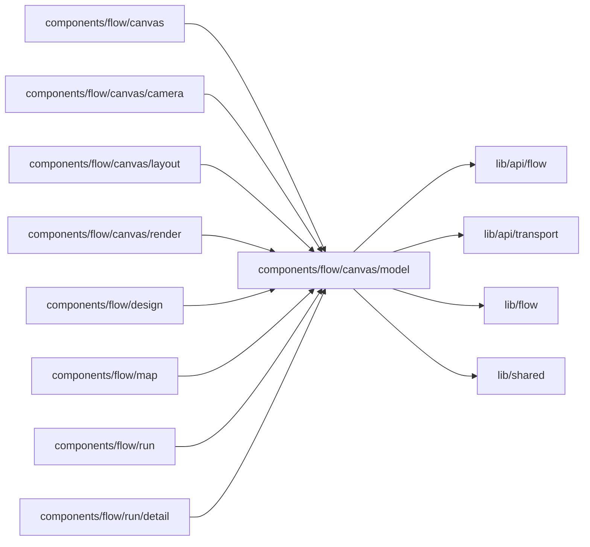

# Canvas model

<!-- BEGIN GENERATED DIRECTORY SUMMARY (scripts/check-readmes.mjs; edit only Purpose) -->
Purpose: Decodes a Flow Definition into the canvas model and derives what the canvas shows: guards, branches, Step groups and context, actionable Steps and a run overlay.

Importers: `components/flow/canvas`, `components/flow/canvas/camera`, `components/flow/canvas/layout`, `components/flow/canvas/render`, `components/flow/design`, `components/flow/map`, `components/flow/run` and `components/flow/run/detail` import this directory.

Imports: it imports `lib/api/flow`, `lib/api/transport`, `lib/flow` and `lib/shared`.

<!-- END GENERATED DIRECTORY SUMMARY -->
