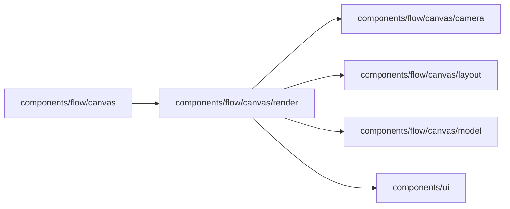

# Canvas rendering

<!-- BEGIN GENERATED DIRECTORY SUMMARY (scripts/check-readmes.mjs; edit only Purpose) -->
Purpose: Renders a laid-out Scene with React Flow: Step and stage cards, routed lines, stage boxes with their ⊕ and ⊖, the zoom bar and opening the view readable.

Importers: `components/flow/canvas` imports this directory.

Imports: it imports `components/flow/canvas/camera`, `components/flow/canvas/layout`, `components/flow/canvas/model` and `components/ui`.

<!-- END GENERATED DIRECTORY SUMMARY -->
