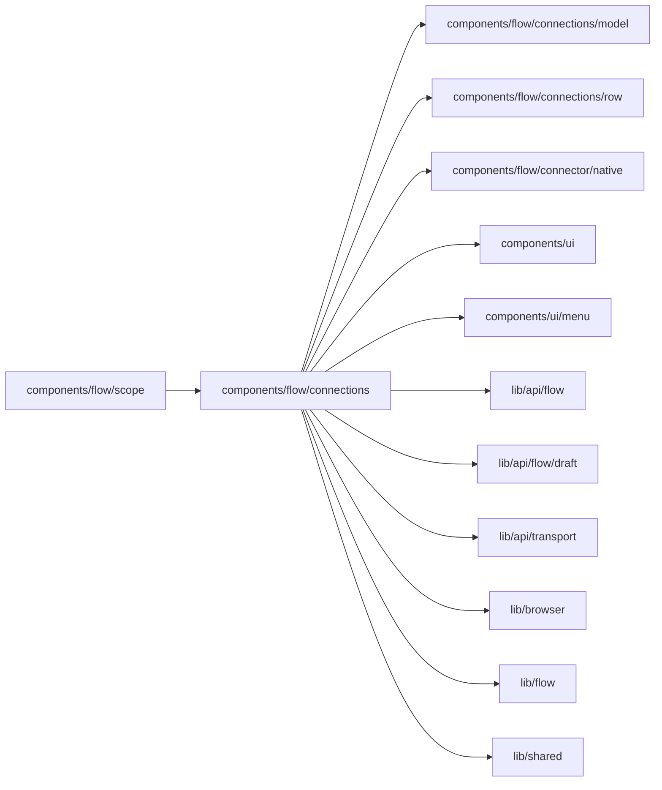

# Connections

<!-- BEGIN GENERATED DIRECTORY SUMMARY (scripts/check-readmes.mjs; edit only Purpose) -->
Purpose: Tools, Setup's table: a row per connection with its settings under it, then the variables, in a Preview column and a Next publish column, each autosaved.

Importers: `components/flow/scope` imports this directory.

Imports: it imports `components/flow/connections/model`, `components/flow/connections/row`, `components/flow/connector/native`, `components/ui`, `components/ui/menu`, `lib/api/flow`, `lib/api/flow/draft`, `lib/api/transport`, `lib/browser`, `lib/flow` and `lib/shared`.

<!-- END GENERATED DIRECTORY SUMMARY -->

`SetupChecklist.tsx` reads two configuration hosts, Preview's and Live's next-publish layer, or on
the Live tab the layer alone, each with its own catalog, UI sessions and autosave queue
(`lib/api/flow/draft`), and lays out the table by the tool panel's width (`@container/tool`, never
the viewport): controls in the row when wide, status chips below 780px, stacked below 520px
(the grid is in [`model/`](model/README.md)). Rows are in [`row/`](row/README.md). It hands the bar above it
(`onNotes`) the connectors' names and what the next publish would do that deserves a look, such as listening
in Preview's channel. `VariablesBlock.tsx` lists
the variables, required first and the optional ones folded, each with a control per column; a secret
shows only whether it is set and never follows Preview. On the Live tab, "Release connections older Live
versions used" lets the TeamSpace delete connections no current version selects; `LiveIdentities.tsx`
lists who and where Live runs as, for the publish wizard.
