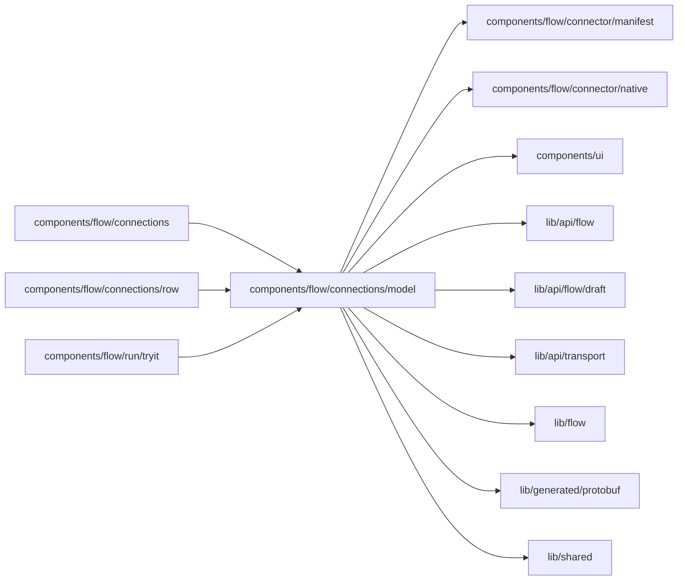

# Setup table model

<!-- BEGIN GENERATED DIRECTORY SUMMARY (scripts/check-readmes.mjs; edit only Purpose) -->
Purpose: What Setup's table reads and how it names things: each column's catalog and sessions, the rows' items and tones, the grid and the reply channel default.

Importers: `components/flow/connections`, `components/flow/connections/row` and `components/flow/run/tryit` import this directory.

Imports: it imports `components/flow/connector/manifest`, `components/flow/connector/native`, `components/ui`, `lib/api/flow`, `lib/api/flow/draft`, `lib/api/transport`, `lib/flow`, `lib/generated/protobuf` and `lib/shared`.

<!-- END GENERATED DIRECTORY SUMMARY -->

`use-scope-catalog.ts` reads one configuration host's connection names, the UI sessions of its working
connections, the Teamspace's connections, the connector catalog and the channels a connection lists. `row-model.ts` names a column
(`SetupSide`), a row's items and setting groups, its tone on each side, and whether the next publish
would listen where Preview listens. `connection-words.ts` holds the status words and the grid the tool
panel's width lays out: controls in the row, chips below 780px, stacked below 520px.
`setting-defaults.ts` fills an empty reply channel from its start trigger's on Preview and tells when a
reply listens in its start trigger's channel.
