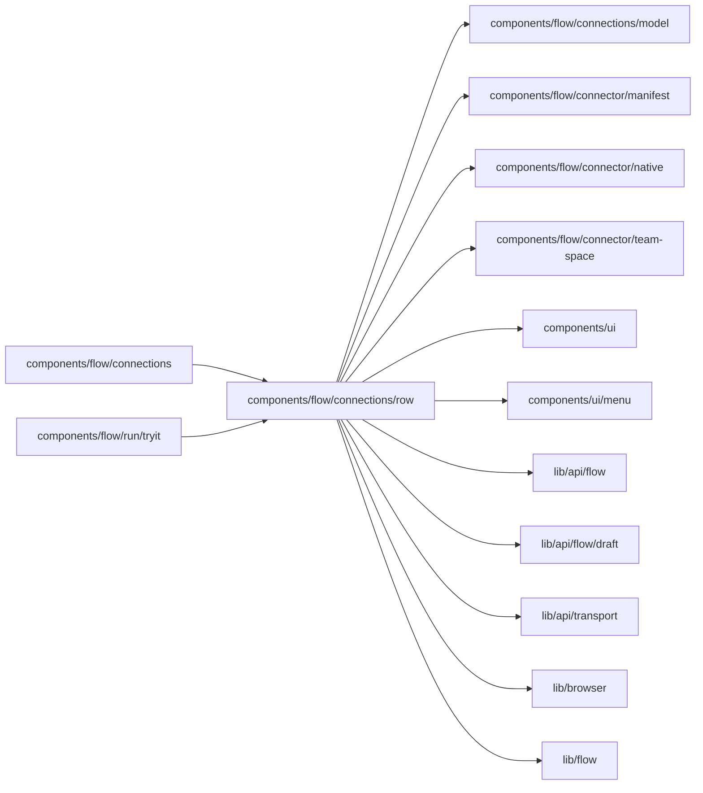

# Setup rows

<!-- BEGIN GENERATED DIRECTORY SUMMARY (scripts/check-readmes.mjs; edit only Purpose) -->
Purpose: One connection's row of Setup's table: its connection on each side, its status chips, and the body with connection settings, a new connection and each setting.

Importers: `components/flow/connections` and `components/flow/run/tryit` import this directory.

Imports: it imports `components/flow/connections/model`, `components/flow/connector/manifest`, `components/flow/connector/native`, `components/flow/connector/team-space`, `components/ui`, `components/ui/menu`, `lib/api/flow`, `lib/api/flow/draft`, `lib/api/transport`, `lib/browser` and `lib/flow`.

<!-- END GENERATED DIRECTORY SUMMARY -->

`SetupRow.tsx` draws the row and folds its body; a row with something missing or worth a look opens by
default, and a jump to any of its items (`focusAnchor`, the bar's and the Publish popover's links)
unfolds it and focuses that item's control, the Next publish one for a `-next` anchor. `ConnectionPicker.tsx`
is a side's connection dropdown: "Same as Preview" first on the next publish, unless the connector is tied
to one address, then the Teamspace's connections and New connection…. `NewConnectionInline.tsx` opens the
Teamspace connection form in the row, selects what it creates for the side that asked, and takes a
sign-in's return by its `pick` key. `RowChips.tsx` shows each side's state on a narrow panel. `RowBody.tsx`
holds the connection settings, one Edit per side, and the settings of each trigger and Step, each a
`SettingCell.tsx` per side; what they read and name is in [`model/`](../model/README.md). Reasons go in the
menu note or an option's tooltip; a blue dot marks a value Live does not run yet.
