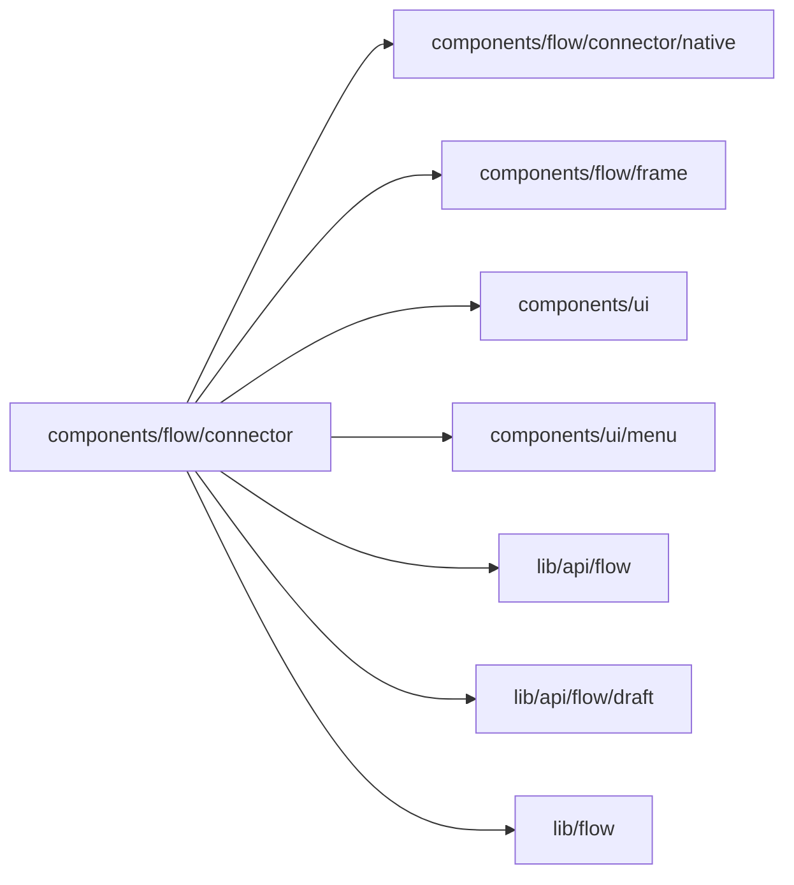

# Connections

<!-- BEGIN GENERATED DIRECTORY SUMMARY (scripts/check-readmes.mjs; edit only Purpose) -->
Purpose: The Connections view of a Project's Flow configuration: connectors, their setup steps and authorization guide, the connection form and its native units.

Importers: no production directory imports this directory.

Imports: it imports `components/flow/connector/native`, `components/flow/frame`, `components/ui`, `components/ui/menu`, `lib/api/flow`, `lib/api/flow/draft` and `lib/flow`.

<!-- END GENERATED DIRECTORY SUMMARY -->
