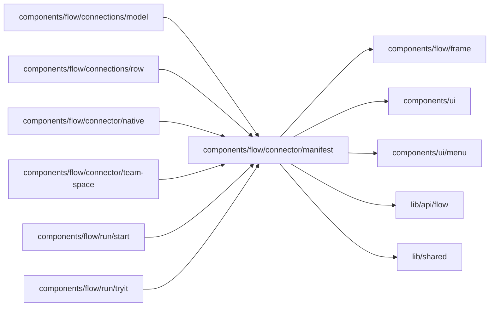

# Connector manifest fields

<!-- BEGIN GENERATED DIRECTORY SUMMARY (scripts/check-readmes.mjs; edit only Purpose) -->
Purpose: Form controls and rules for the fields a connector manifest declares: inputs and defaults, authorization methods, and JSON Pointer reads and merges of unit values.

Importers: `components/flow/connections/model`, `components/flow/connections/row`, `components/flow/connector/native`, `components/flow/connector/team-space`, `components/flow/run/start` and `components/flow/run/tryit` import this directory.

Imports: it imports `components/flow/frame`, `components/ui`, `components/ui/menu`, `lib/api/flow` and `lib/shared`.

<!-- END GENERATED DIRECTORY SUMMARY -->
