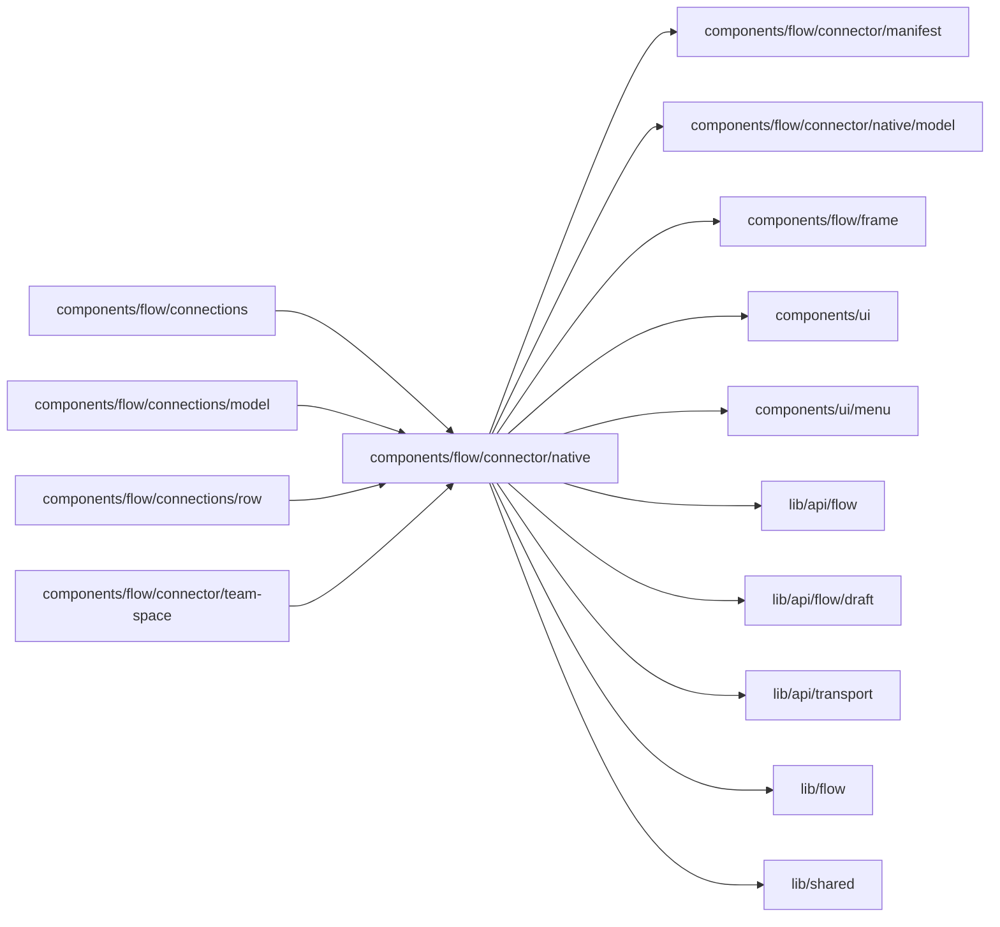

# Native connector units

<!-- BEGIN GENERATED DIRECTORY SUMMARY (scripts/check-readmes.mjs; edit only Purpose) -->
Purpose: The native units a connector manifest declares, the host that runs their declared provider commands and saves their values, model ID rules and picker options.

Importers: `components/flow/connections`, `components/flow/connections/model`, `components/flow/connections/row` and `components/flow/connector/team-space` import this directory.

Imports: it imports `components/flow/connector/manifest`, `components/flow/connector/native/model`, `components/flow/frame`, `components/ui`, `components/ui/menu`, `lib/api/flow`, `lib/api/flow/draft`, `lib/api/transport`, `lib/flow` and `lib/shared`.

<!-- END GENERATED DIRECTORY SUMMARY -->
