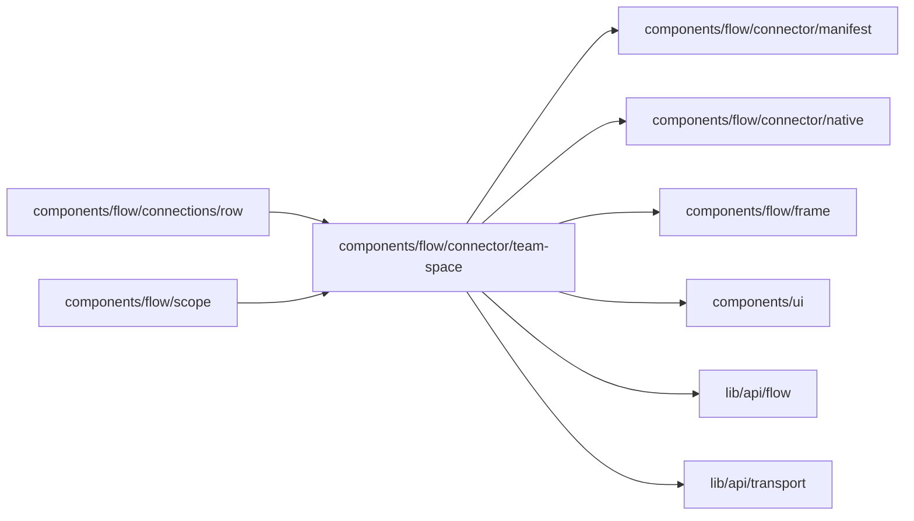

# components/flow/connector/team-space

<!-- BEGIN GENERATED DIRECTORY SUMMARY (scripts/check-readmes.mjs; edit only Purpose) -->
Purpose: A TeamSpace connection's editor with the connector's own form, and the picker that chooses one for a Project's connection name.

Importers: `components/flow/connections/row` and `components/flow/scope` import this directory.

Imports: it imports `components/flow/connector/manifest`, `components/flow/connector/native`, `components/flow/frame`, `components/ui`, `lib/api/flow` and `lib/api/transport`.

<!-- END GENERATED DIRECTORY SUMMARY -->

The editor writes through `teamSpaceConnectionWriter`
(`lib/api/flow/team-space-connection.ts`): a new connection is created on its
first save or authorization under one request ID, so a retried save is the
same connection. An OAuth method leaves for the provider through
`/api/connector-oauth/start`, whose callback returns to the page with the
outcome. Where the platform offers its own OAuth application for the method,
the form offers it first.

The picker lists the TeamSpace's connections of the declared connector, major
version and method and selects one through the caller's `onSelect`, or creates
one from the declared release, which may be a release candidate, and selects
it. Its `pick` query parameter brings an authorization back to the same
connection name, which then selects the connection the authorization
completed.
