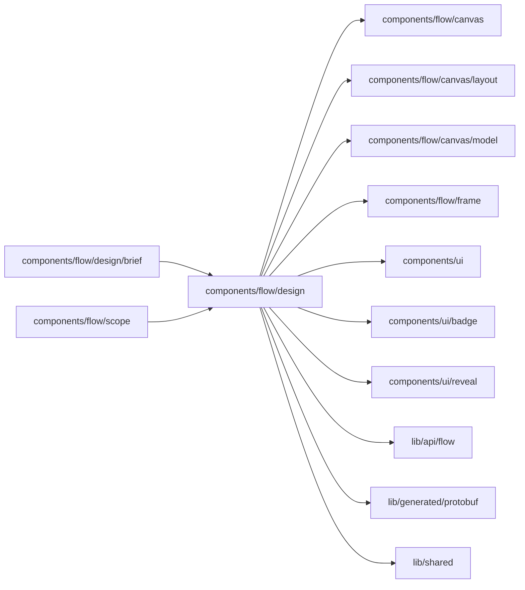

# Flow design view

<!-- BEGIN GENERATED DIRECTORY SUMMARY (scripts/check-readmes.mjs; edit only Purpose) -->
Purpose: Draws an agent's Flow design with the Flow canvas and its heading, compares it with the current source for marks and change lines, and holds its Process Brief.

Importers: `components/flow/design/brief` and `components/flow/scope` import this directory.

Imports: it imports `components/flow/canvas`, `components/flow/canvas/layout`, `components/flow/canvas/model`, `components/flow/frame`, `components/ui`, `components/ui/badge`, `components/ui/reveal`, `lib/api/flow`, `lib/generated/protobuf` and `lib/shared`.

<!-- END GENERATED DIRECTORY SUMMARY -->

A design is the optional `design` of a requirements card, read through `GetFlowDesign`
([design before implementation](../../../../../docs/architecture/design-first/studio.md)). Its hosts in
`components/build` and `components/session` reach it only through `components/flow/scope`.

| File                  | Responsibility                                                                                                                                                                                                               |
| --------------------- | ---------------------------------------------------------------------------------------------------------------------------------------------------------------------------------------------------------------------------- |
| `design-graph.ts`     | One designed Flow as the subset of Flow Definition Graph 2.0 the canvas decoder reads: Steps, groups, waits, decisions, failure routes, Channels, Actions and Attributes, with `source.language` "design" and `valid: false` |
| `design-compare.ts`   | A design against the current source per Flow type: new, changed or unchanged Flows, the marks of the designed Steps and the change lines in the canvas's names                                                               |
| `DesignFlowView.tsx`  | The Flow tab's design view: the marked canvas through `FlowGraphCanvas`, with the host's title and the count of written Steps on its corner while the design is built; no marks on a process the source does not hold        |
| `DesignHeading.tsx`   | The process title and one status chip on the canvas's top-left corner, such as "Drafting" or "Building · 4 of 6 steps written"                                                                                               |
| `DesignStepPanel.tsx` | A designed Step under its title: its explanation, wait, ways out and the features it serves, with its Go names behind More details                                                                                           |
| `brief/`              | The Process Brief: the card's summary under the canvas with one More details, and the drafting view                                                                                                                          |

The expansion goes through the canvas's own decoder and its split of the main story from failure
handling, so a design and its implementation draw the same picture. A designed Flow never enters a
catalog, so it has no Runs, Start or Action control.
