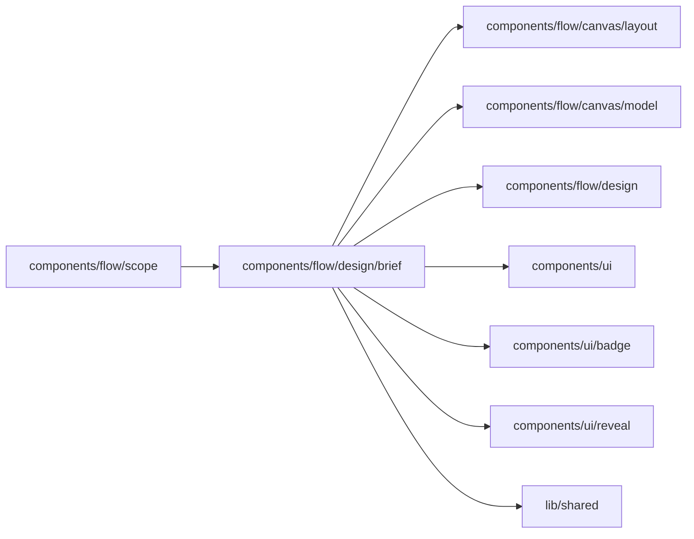

# Process Brief

<!-- BEGIN GENERATED DIRECTORY SUMMARY (scripts/check-readmes.mjs; edit only Purpose) -->
Purpose: The Process Brief on the Flow tab: the current requirements card and its Flow design in business words, a summary grid above the drawing, Change something, and the card's draft.

Importers: `components/flow/scope` imports this directory.

Imports: it imports `components/flow/canvas/layout`, `components/flow/canvas/model`, `components/flow/design`, `components/ui`, `components/ui/badge`, `components/ui/reveal` and `lib/shared`.

<!-- END GENERATED DIRECTORY SUMMARY -->

The Brief reads the current version of the requirements, which the agent recorded when it showed the
card and builds from at once, together with its Flow design
([design before implementation](../../../../../../docs/architecture/design-first/studio.md#the-process-brief)).
`components/build/DesignSurface.tsx` hosts it through `components/flow/scope` and passes the card,
the design, the drawing and the actions as props, so this directory reads no Session.

| File                | Responsibility                                                                                                                          |
| ------------------- | --------------------------------------------------------------------------------------------------------------------------------------- |
| `brief-model.ts`    | A design in business words: Steps in the canvas's reading order with its titles, what starts each process, who acts, rules and failures |
| `ProcessBrief.tsx`  | The Brief: its header, the summary grid, More details, the drawing below and its foot                                                   |
| `BriefSections.tsx` | The parts with their headings: grid cells, lines, the rules, the Steps, the change lines, the outline and the apps                      |
| `BriefActions.tsx`  | Change something…, which opens a box in place with Send changes: a message, steered into a running turn, that revises the card          |
| `DraftBrief.tsx`    | The Brief, drafting, while the agent writes its card: the draft's title, summary, features, apps and Step names as they stream, no drawing |

The summary grid holds the short parts (Starts when, People, Rules and exceptions, Apps) in three
columns when its container (`brief`) is wide, then two, then one; container queries, never the
viewport. What it does, You need to prepare, Done when, Features, the change lines and the outline
wait behind one **More details** (`brief.more`); the apps' connections and operations behind their
own (`brief.apps`). The Brief derives its main story and failure count from the canvas's own split
(`failureHandling` and `mainStory`), so it counts the Steps the canvas folds away. Its Steps list
shows only for a design it does not draw.

While the agent writes a requirements card, its host shows the card's latest draft, which the
Session Watch streams at most once a second, as the Brief, drafting (`DraftBrief`): a plain list of
what arrived, without the summary grid or a drawing, until the recorded card replaces it.
