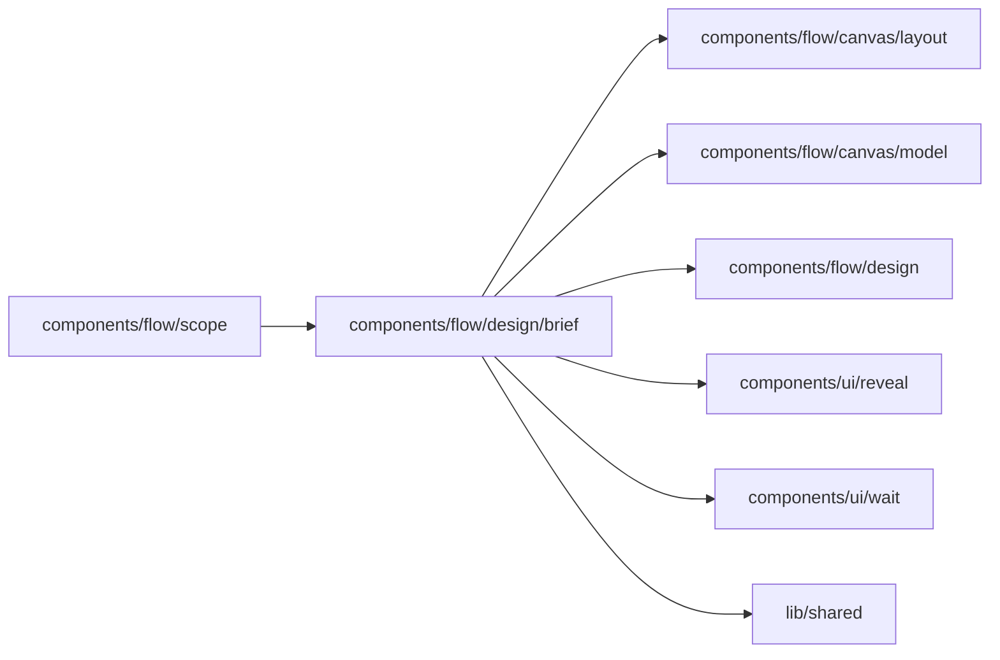

# Process Brief

<!-- BEGIN GENERATED DIRECTORY SUMMARY (scripts/check-readmes.mjs; edit only Purpose) -->
Purpose: The Process Brief on the Flow tab while a design is drafted or built: the summary line under the canvas with one More details, and the draft's Step names.

Importers: `components/flow/scope` imports this directory.

Imports: it imports `components/flow/canvas/layout`, `components/flow/canvas/model`, `components/flow/design`, `components/ui/reveal`, `components/ui/wait` and `lib/shared`.

<!-- END GENERATED DIRECTORY SUMMARY -->

The Brief reads the current version of the requirements, which the agent recorded when it showed the
card and builds from at once, together with its Flow design
([design before implementation](../../../../../../docs/architecture/design-first/studio.md#the-process-brief)).
`components/build/DesignSurface.tsx` hosts it through `components/flow/scope` and passes the card,
the design, the drawing and a note as props, so this directory reads no Session.

| File                | Responsibility                                                                                                                                               |
| ------------------- | ------------------------------------------------------------------------------------------------------------------------------------------------------------ |
| `brief-model.ts`    | A design in business words: what starts each process, who acts, the rules and failures in the canvas's titles and reading order, and what the person sets up |
| `ProcessBrief.tsx`  | The Brief while the design is built: the drawing, or an empty canvas for a card without a design, the summary line and the More details panel                |
| `BriefSections.tsx` | The parts with their headings: lines, rules, features, bullets, the change lines, the outline, and the foot under the canvas                                 |
| `DraftBrief.tsx`    | The Flow tab while the agent writes its card: "Drafting" on the corner, the drafted Step names as dashed boxes, the summary as it arrives                    |

The canvas leads. While the design is drafted or built, the Brief is the process title and one
status chip on the canvas's corner (`DesignHeading` in `components/flow/design`), the card's own
one-line summary under the canvas, never a sentence put together from inferred parts, and one
**More details** (`brief.more`) that holds, each only when it has content: What you'll set up, Who
decides, Starts when, Rules and exceptions, What it must do, How it's accepted, and a nested More
details (`brief.code`) with the outline and what the design changes. The foot keeps to the lower
part and scrolls on its own, so the drawing always shows. The Brief derives its rules and failure
count from the canvas's own split (`failureHandling` and `mainStory`), so it counts the Steps the
canvas folds away. Once the design is built its host shows the drawing alone. There is no Change
something: a person changes the card only in the chat.

While the agent writes a requirements card, its host shows the card's latest draft, which the
Session Watch streams at most once a second (`DraftBrief`): "Drafting" on the corner, the drafted
main-story Step names per process as a row of dashed boxes (a Step only failure routes reach stays
out, as on the drawing) and the summary as it arrives, with the features behind More details, until
the recorded card's drawing replaces it.
