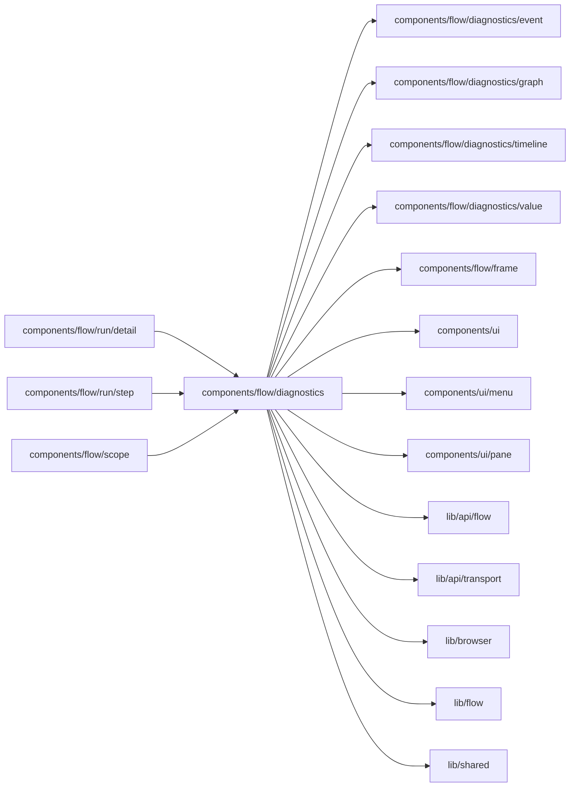

# Flow diagnostics

<!-- BEGIN GENERATED DIRECTORY SUMMARY (scripts/check-readmes.mjs; edit only Purpose) -->
Purpose: The Diagnostics pages of a Flow and one run: overview, live state, Streams, the run record, and the Stop, Time Travel and channel operation dialogs.

Importers: `components/flow/run/detail`, `components/flow/run/step` and `components/flow/scope` import this directory.

Imports: it imports `components/flow/diagnostics/event`, `components/flow/diagnostics/graph`, `components/flow/diagnostics/timeline`, `components/flow/diagnostics/value`, `components/flow/frame`, `components/ui`, `components/ui/menu`, `components/ui/pane`, `lib/api/flow`, `lib/api/transport`, `lib/browser`, `lib/flow` and `lib/shared`.

<!-- END GENERATED DIRECTORY SUMMARY -->
