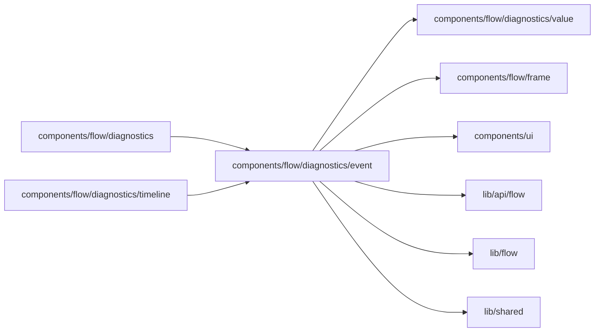

# History event details

<!-- BEGIN GENERATED DIRECTORY SUMMARY (scripts/check-readmes.mjs; edit only Purpose) -->
Purpose: Renders the details of one history event: its Step method sections, effects, failure and the Step options it ran with.

Importers: `components/flow/diagnostics` and `components/flow/diagnostics/timeline` import this directory.

Imports: it imports `components/flow/diagnostics/value`, `components/flow/frame`, `components/ui`, `lib/api/flow`, `lib/flow` and `lib/shared`.

<!-- END GENERATED DIRECTORY SUMMARY -->
