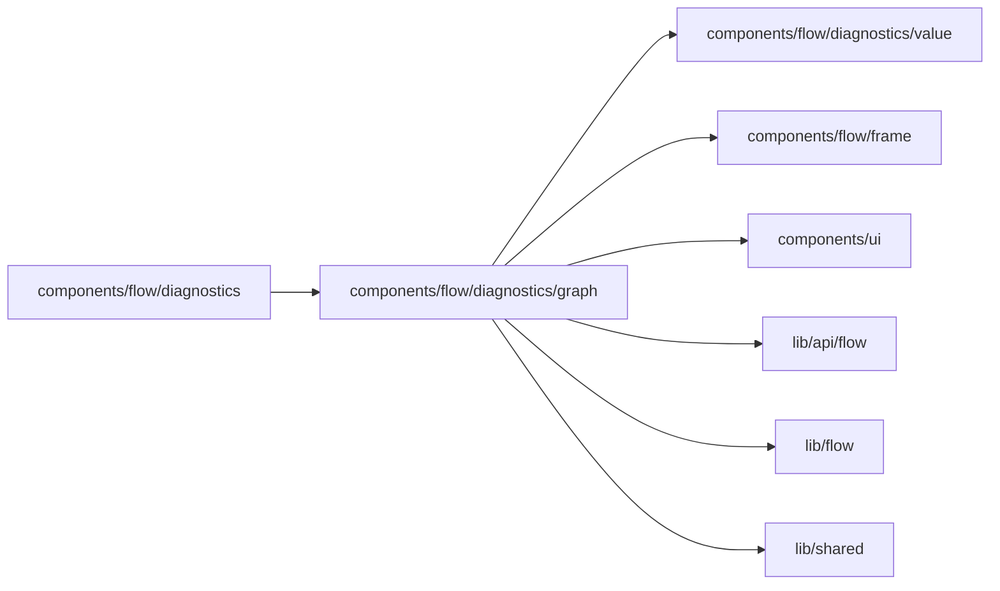

# Execution graph

<!-- BEGIN GENERATED DIRECTORY SUMMARY (scripts/check-readmes.mjs; edit only Purpose) -->
Purpose: Reconstructs and draws a run's execution graph from its history events, without applying a newer Flow Definition.

Importers: `components/flow/diagnostics` imports this directory.

Imports: it imports `components/flow/diagnostics/value`, `components/flow/frame`, `components/ui`, `lib/api/flow`, `lib/flow` and `lib/shared`.

<!-- END GENERATED DIRECTORY SUMMARY -->
