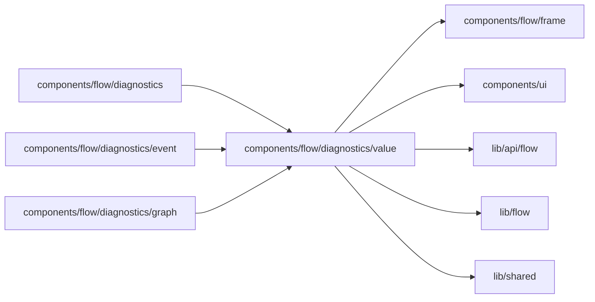

# Diagnostic values

<!-- BEGIN GENERATED DIRECTORY SUMMARY (scripts/check-readmes.mjs; edit only Purpose) -->
Purpose: Renders the values a run's history carries: typed fields, structured and JSON values, Step options and decisions, waiting conditions and persistence groups.

Importers: `components/flow/diagnostics`, `components/flow/diagnostics/event` and `components/flow/diagnostics/graph` import this directory.

Imports: it imports `components/flow/frame`, `components/ui`, `lib/api/flow`, `lib/flow` and `lib/shared`.

<!-- END GENERATED DIRECTORY SUMMARY -->
