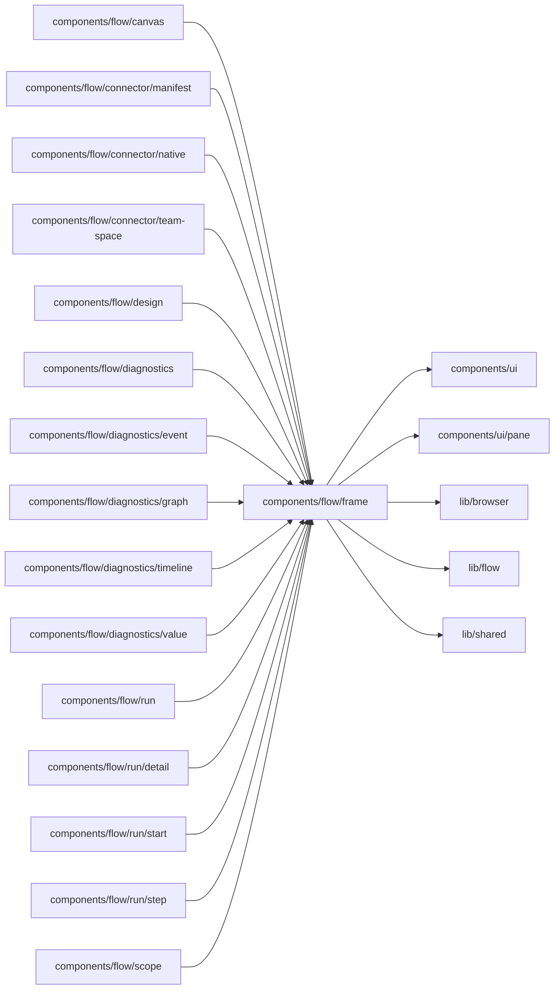

# Flow frame

<!-- BEGIN GENERATED DIRECTORY SUMMARY (scripts/check-readmes.mjs; edit only Purpose) -->
Purpose: What every Flow view shares: the FlowFrame root, links to a Flow target, pane presets with their storage keys, and the Runs workspace class constants.

Importers: `components/flow/canvas`, `components/flow/connector/manifest`, `components/flow/connector/native`, `components/flow/connector/team-space`, `components/flow/design`, `components/flow/diagnostics`, `components/flow/diagnostics/event`, `components/flow/diagnostics/graph`, `components/flow/diagnostics/timeline`, `components/flow/diagnostics/value`, `components/flow/run`, `components/flow/run/detail`, `components/flow/run/start`, `components/flow/run/step` and `components/flow/scope` import this directory.

Imports: it imports `components/ui`, `components/ui/pane`, `lib/browser`, `lib/flow` and `lib/shared`.

<!-- END GENERATED DIRECTORY SUMMARY -->
