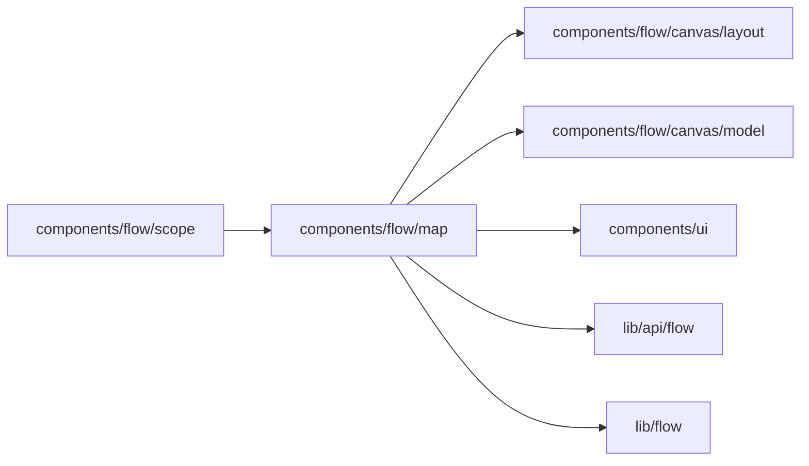

# Project map

<!-- BEGIN GENERATED DIRECTORY SUMMARY (scripts/check-readmes.mjs; edit only Purpose) -->
Purpose: The Flow tab's project map: a card per valid Flow Type with its one-line summary, its stages, apps, child Flows and change markers.

Importers: `components/flow/scope` imports this directory.

Imports: it imports `components/flow/canvas/layout`, `components/flow/canvas/model`, `components/ui`, `lib/api/flow` and `lib/flow`.

<!-- END GENERATED DIRECTORY SUMMARY -->

The map reads the catalog of the Flow scope it is mounted in (the prepared source on Preview, the
Live Release on Live) and decodes each valid Flow Definition with the canvas's decoder. Each card shows
the process's one-line summary, its stages (the `dex:group` labels) in reading order, how many Steps
wait for someone, the apps its connectors reach, and the runs waiting for a person. No Flow Definition
carries a summary yet: `dex:explanation` describes Steps, not the Flow, so the line says so until the
analyser emits one for the Flow. A Step waits for someone when an Action answers its Channel, another
Channel waits for someone outside, or the analyser could not resolve its wait. A process that starts
another Process of this Project names it; declared relations between Processes are phase 2.
