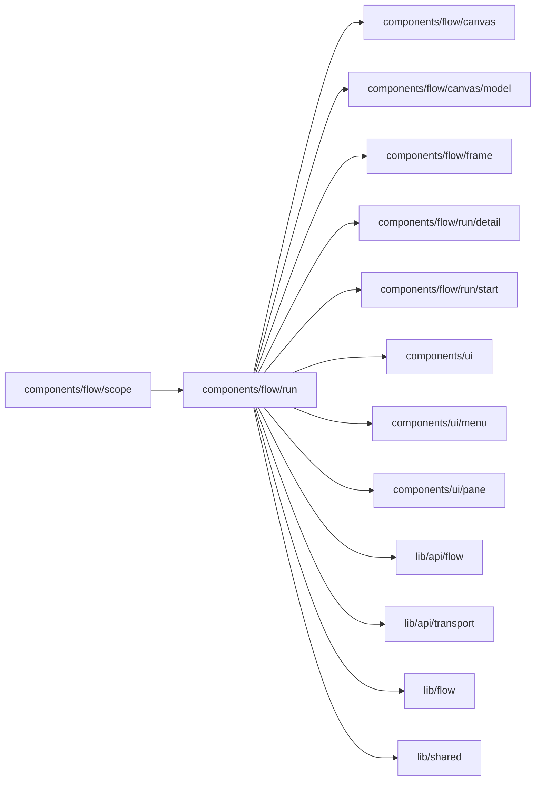

# Runs and Inbox

<!-- BEGIN GENERATED DIRECTORY SUMMARY (scripts/check-readmes.mjs; edit only Purpose) -->
Purpose: The Runs and Inbox views: the run list column with Runs | Events, search and its query, run groups, and the hooks that search runs and route Flow types.

Importers: `components/flow/scope` imports this directory.

Imports: it imports `components/flow/canvas`, `components/flow/canvas/model`, `components/flow/frame`, `components/flow/run/detail`, `components/flow/run/start`, `components/ui`, `components/ui/menu`, `components/ui/pane`, `lib/api/flow`, `lib/api/transport`, `lib/flow` and `lib/shared`.

<!-- END GENERATED DIRECTORY SUMMARY -->
