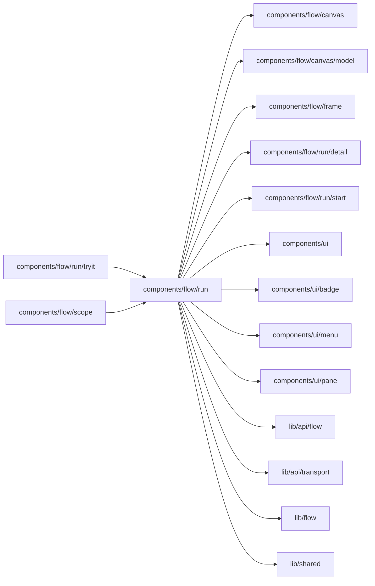

# Runs and Inbox

<!-- BEGIN GENERATED DIRECTORY SUMMARY (scripts/check-readmes.mjs; edit only Purpose) -->
Purpose: The Runs and Inbox views: the run list column with its health strip, Filter and events slots, run groups, the run search and the hook that routes Flow types.

Importers: `components/flow/run/tryit` and `components/flow/scope` import this directory.

Imports: it imports `components/flow/canvas`, `components/flow/canvas/model`, `components/flow/frame`, `components/flow/run/detail`, `components/flow/run/start`, `components/ui`, `components/ui/badge`, `components/ui/menu`, `components/ui/pane`, `lib/api/flow`, `lib/api/transport`, `lib/flow` and `lib/shared`.

<!-- END GENERATED DIRECTORY SUMMARY -->

Runs and Inbox make one composite search of each displayed Flow type and, for
Runs, its health groups. While visible, each list schedules its next quiet read
10 seconds after the last result. A failed quiet read, including a failed group
read, doubles the interval to at most 120 seconds; a 429 also backs off after a
reader-initiated search. A `Retry-After` hint can postpone the next read beyond
that cap. Success resets the interval to 10 seconds. Reader-initiated searches
run immediately. Failed reads preserve the last rows as stale; a 429 before the
first result also uses the stale state instead of the hard unreachable state.
