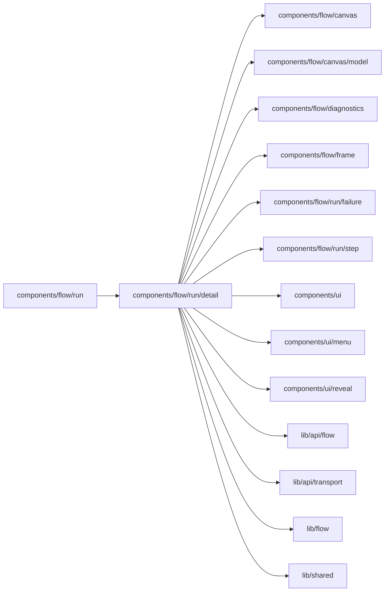

# Run detail

<!-- BEGIN GENERATED DIRECTORY SUMMARY (scripts/check-readmes.mjs; edit only Purpose) -->
Purpose: The selected run's drawer: header, Display and Actions, QR code input, typed values, UI slots, run copy and the liveness of what the reader holds.

Importers: `components/flow/run` imports this directory.

Imports: it imports `components/flow/canvas`, `components/flow/canvas/model`, `components/flow/diagnostics`, `components/flow/frame`, `components/flow/run/failure`, `components/flow/run/step`, `components/ui`, `components/ui/menu`, `components/ui/reveal`, `lib/api/flow`, `lib/api/transport`, `lib/flow` and `lib/shared`.

<!-- END GENERATED DIRECTORY SUMMARY -->
