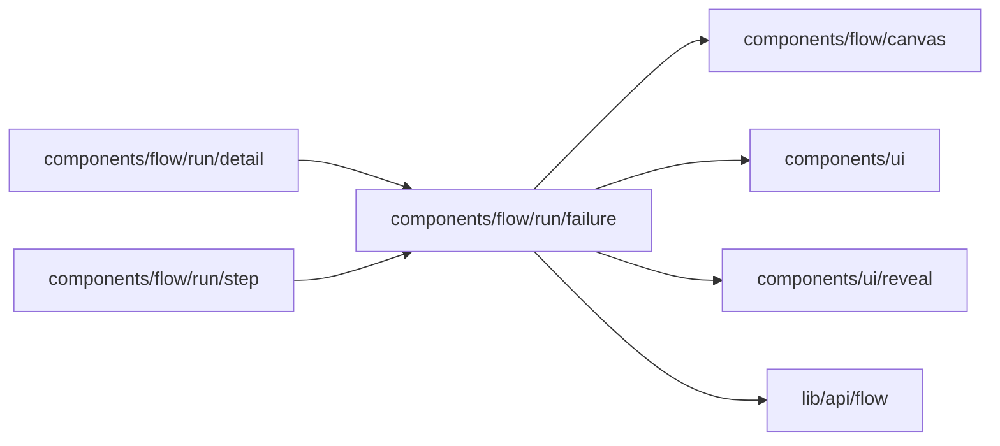

# Run failure

<!-- BEGIN GENERATED DIRECTORY SUMMARY (scripts/check-readmes.mjs; edit only Purpose) -->
Purpose: A failed Step or run at the top of the run drawer in business terms: what happened, what happens now, the engine's words behind More details.

Importers: `components/flow/run/detail` and `components/flow/run/step` import this directory.

Imports: it imports `components/flow/canvas`, `components/ui`, `components/ui/reveal` and `lib/api/flow`.

<!-- END GENERATED DIRECTORY SUMMARY -->
