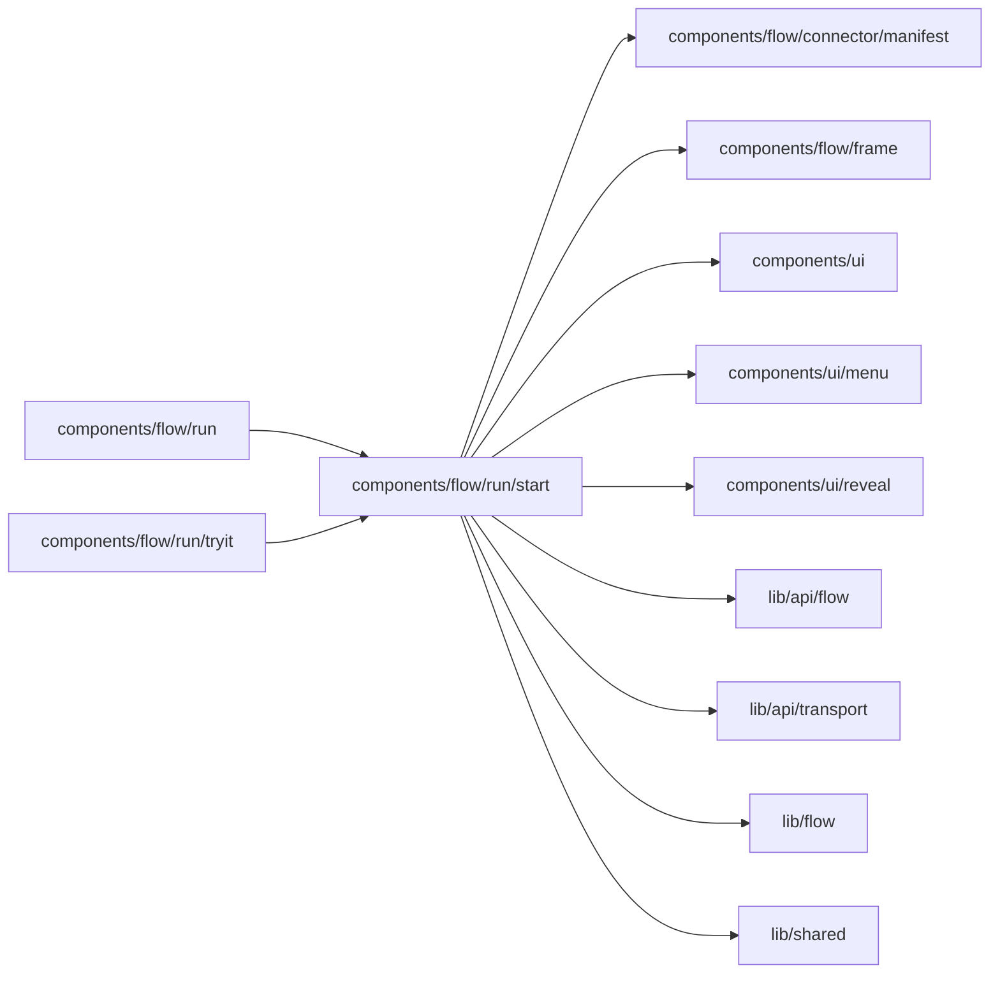

# Start Flow

<!-- BEGIN GENERATED DIRECTORY SUMMARY (scripts/check-readmes.mjs; edit only Purpose) -->
Purpose: A process's start form in business words, inline or in its dialog, with typed start input and recovery of a start whose response was uncertain.

Importers: `components/flow/run` and `components/flow/run/tryit` import this directory.

Imports: it imports `components/flow/connector/manifest`, `components/flow/frame`, `components/ui`, `components/ui/menu`, `components/ui/reveal`, `lib/api/flow`, `lib/api/transport`, `lib/flow` and `lib/shared`.

<!-- END GENERATED DIRECTORY SUMMARY -->
