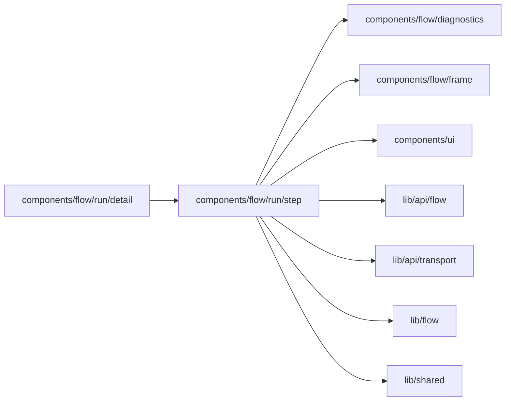

# Run step actions

<!-- BEGIN GENERATED DIRECTORY SUMMARY (scripts/check-readmes.mjs; edit only Purpose) -->
Purpose: What a reader may do at the clicked Step of a run: open its Inbox item, Time travel, ask the agent, or fix a Live failure on Preview.

Importers: `components/flow/run/detail` imports this directory.

Imports: it imports `components/flow/diagnostics`, `components/flow/frame`, `components/ui`, `lib/api/flow`, `lib/api/transport`, `lib/flow` and `lib/shared`.

<!-- END GENERATED DIRECTORY SUMMARY -->
