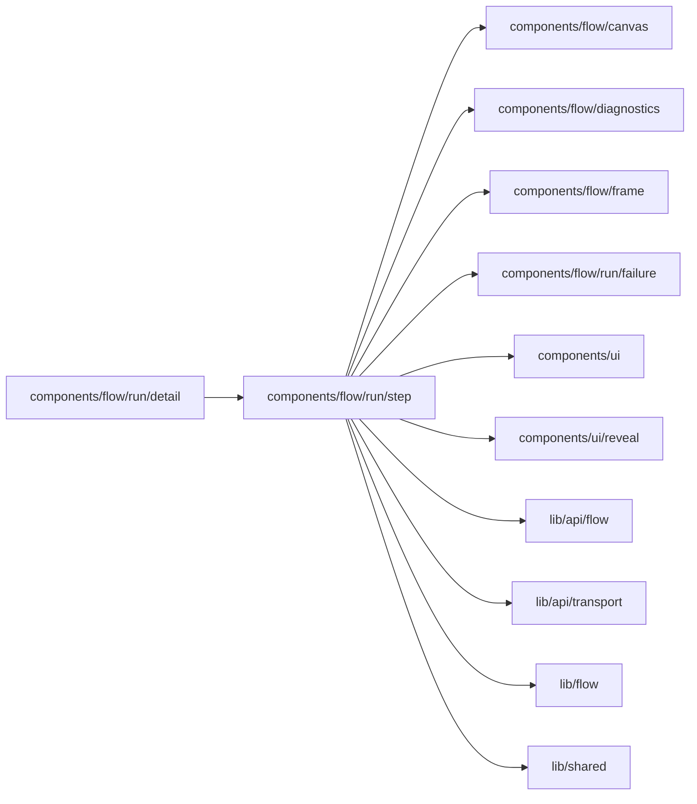

# Run step actions

<!-- BEGIN GENERATED DIRECTORY SUMMARY (scripts/check-readmes.mjs; edit only Purpose) -->
Purpose: What a reader may do at a run's clicked Step: open its Inbox item, ask the agent, retry a failed Step, have the agent fix it, or Time travel.

Importers: `components/flow/run/detail` imports this directory.

Imports: it imports `components/flow/canvas`, `components/flow/diagnostics`, `components/flow/frame`, `components/flow/run/failure`, `components/ui`, `components/ui/reveal`, `lib/api/flow`, `lib/api/transport`, `lib/flow` and `lib/shared`.

<!-- END GENERATED DIRECTORY SUMMARY -->
