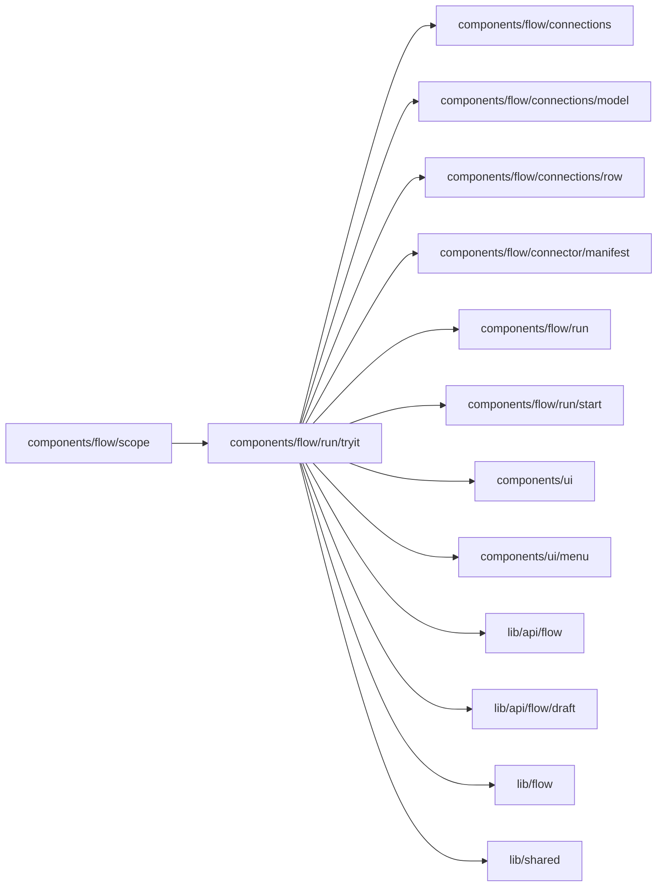

# Try it

<!-- BEGIN GENERATED DIRECTORY SUMMARY (scripts/check-readmes.mjs; edit only Purpose) -->
Purpose: Runs' first view before Preview has a run: what the version still needs, connected in place with Setup's controls, then the process's start form inline.

Importers: `components/flow/scope` imports this directory.

Imports: it imports `components/flow/connections`, `components/flow/connections/model`, `components/flow/connections/row`, `components/flow/connector/manifest`, `components/flow/run`, `components/flow/run/start`, `components/ui`, `components/ui/menu`, `lib/api/flow`, `lib/api/flow/draft`, `lib/flow` and `lib/shared`.

<!-- END GENERATED DIRECTORY SUMMARY -->
