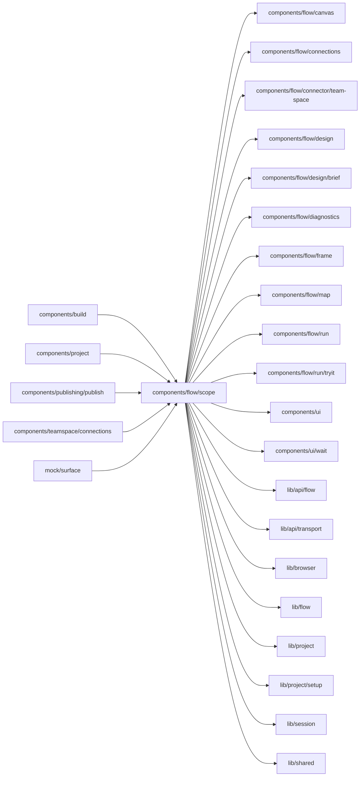

# Flow scope

<!-- BEGIN GENERATED DIRECTORY SUMMARY (scripts/check-readmes.mjs; edit only Purpose) -->
Purpose: Studio's only entry into the Flow UI: binds it to a Project-scoped Flow API, supplies navigation and the catalog notice, and loads its views on demand.

Importers: `components/build`, `components/project`, `components/publishing/publish`, `components/teamspace/connections` and `mock/surface` import this directory.

Imports: it imports `components/flow/canvas`, `components/flow/connections`, `components/flow/connector/team-space`, `components/flow/design`, `components/flow/design/brief`, `components/flow/diagnostics`, `components/flow/frame`, `components/flow/map`, `components/flow/run`, `components/flow/run/tryit`, `components/ui`, `components/ui/wait`, `lib/api/flow`, `lib/api/transport`, `lib/browser`, `lib/flow`, `lib/project`, `lib/project/setup`, `lib/session` and `lib/shared`.

<!-- END GENERATED DIRECTORY SUMMARY -->

LiveFlowScope checks the selected Release against Project's current Live
pointer and binds every Flow API request to that pointer's Deployment ID.
The FlowCatalogProvider reads definitions from the deployed READY build through
that API, not GetRelease's prepared source. A later FAILED rebuild therefore
does not hide the running deployment's catalog. A deployment change remounts
the scope, cancelling the previous requests and closing its dialogs; stale
targets still fail server-side admission.

ExampleFlowScope draws, for a Project that starts from an example while its
Session's head is still the setup commit and no processes are built
(`ProjectStageState.drawsExample`), the example's own Flow Definitions as a
read-only catalog: they are the definitions of that commit's tree, so it never
substitutes them for a later push, which waits for its own build.
`useExampleDefinitions` (`lib/project`) imports the example's generated file only
when its tree is the one `ProjectSnapshot.example` names, so a Studio build that
holds the example at another tree draws nothing of it and says the processes are
not built yet. The scope names no example.

SessionFlowScope's prepared source is the head's when the Preview has built it.
Until then a managed Project's setup commit shows the template's generated
Design, and a later push keeps the real flow: the last built source this browser
read (`ProcessDefinitionsProvider`'s `lastBuilt`) as a read-only catalog, else the
definitions the running Preview serves, else it says the processes of this
version are not built yet. It never draws a design instead.

SessionFlowScope's running source, which Runs and Inbox on Preview read, exists
only while the Preview runs; otherwise they say Preview is not running, with the
Start the page passes, which leads to Setup instead while the Preview lacks
settings. `WhilePreviewRuns` applies the same rule to mock Studio's fixture runs.
