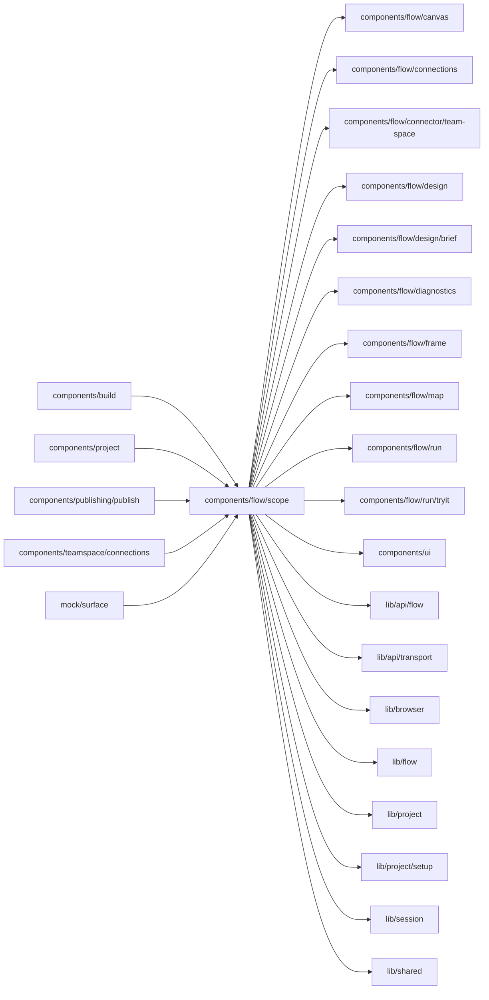

# Flow scope

<!-- BEGIN GENERATED DIRECTORY SUMMARY (scripts/check-readmes.mjs; edit only Purpose) -->
Purpose: Studio's only entry into the Flow UI: binds it to a Project-scoped Flow API, supplies navigation and the catalog notice, and loads its views on demand.

Importers: `components/build`, `components/project`, `components/publishing/publish`, `components/teamspace/connections` and `mock/surface` import this directory.

Imports: it imports `components/flow/canvas`, `components/flow/connections`, `components/flow/connector/team-space`, `components/flow/design`, `components/flow/design/brief`, `components/flow/diagnostics`, `components/flow/frame`, `components/flow/map`, `components/flow/run`, `components/flow/run/tryit`, `components/ui`, `lib/api/flow`, `lib/api/transport`, `lib/browser`, `lib/flow`, `lib/project`, `lib/project/setup`, `lib/session` and `lib/shared`.

<!-- END GENERATED DIRECTORY SUMMARY -->

LiveFlowScope checks the selected Release against Project's current Live
pointer and binds every Flow API request to that pointer's Deployment ID.
The FlowCatalogProvider reads definitions from the deployed READY build through
that API, not GetRelease's prepared source. A later FAILED rebuild therefore
does not hide the running deployment's catalog. A deployment change remounts
the scope, cancelling the previous requests and closing its dialogs; stale
targets still fail server-side admission.
