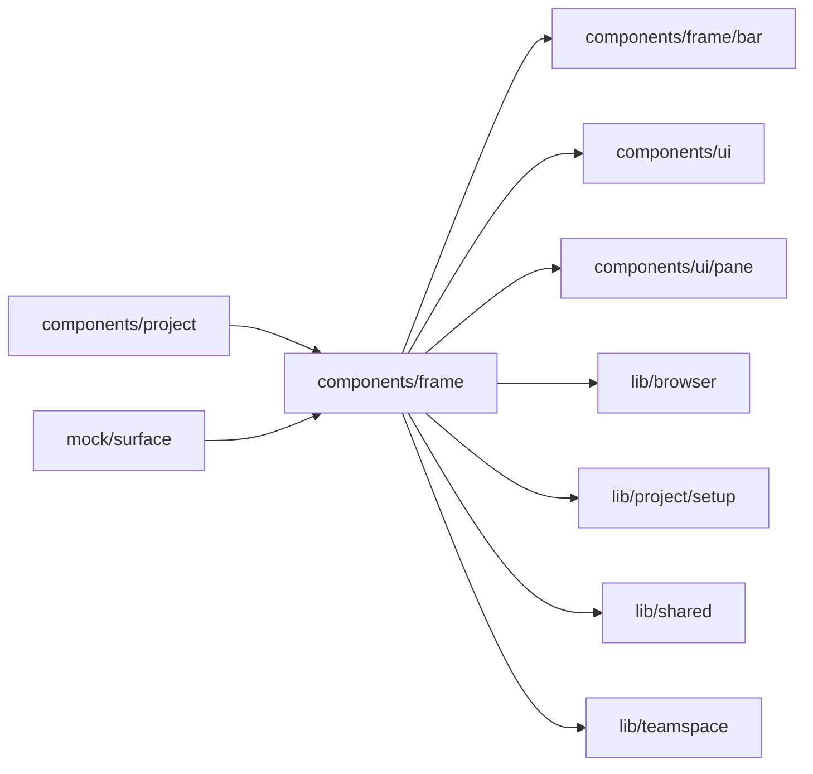

# Builder frame

<!-- BEGIN GENERATED DIRECTORY SUMMARY (scripts/check-readmes.mjs; edit only Purpose) -->
Purpose: The Project Builder's frame: the bar, the chat column with its rail, Tools' list, the links between surfaces and versions, and the surface registry.

Importers: `components/project` and `mock/surface` import this directory.

Imports: it imports `components/frame/bar`, `components/ui`, `components/ui/pane`, `lib/browser`, `lib/project/setup`, `lib/shared` and `lib/teamspace`.

<!-- END GENERATED DIRECTORY SUMMARY -->

The frame is the reference implementation of the
[visual spec](../../../../docs/architecture/studio-setup/studio.md) and its
[build handoff](../../../../docs/architecture/studio-setup/studio.md). It knows no
Session, Flow API or publishing call: the page passes the chat, the folded chat's rail and the
surface's content, and the frame draws everything around them.

- `surface-registry.ts` declares the surfaces once (label, icon, whether the Preview | Live switch
  sets them, the least role that may open them) and the tools of Tools. The surface and tool names
  themselves are URL segments, declared in `lib/shared/studio-routes.ts`. Production and the mock
  render the same registry, so a surface the registry lacks cannot appear anywhere.
- `ProjectFrame` holds the chat column's width as `--chat-w` on the frame, so the bar's left block
  is exactly as wide as the chat and the tabs start where the surface does.
- `use-frame-links.ts` keeps the version (`?v=live`) and the caller's persistent parameters on every
  move between surfaces, and keeps the surface on every move between versions.
- Widths and folded rails are per browser (`STORAGE_KEYS`), never shared.
