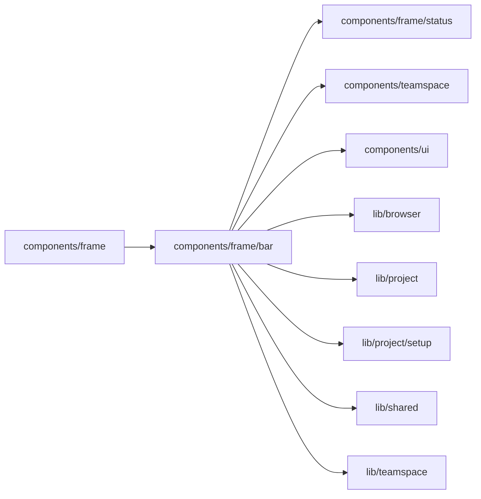

# Builder bar

<!-- BEGIN GENERATED DIRECTORY SUMMARY (scripts/check-readmes.mjs; edit only Purpose) -->
Purpose: The Builder's one 48px bar: the Project switch, the Preview | Live switch, the surface tabs, the actions, and how far the bar gives way when narrow.

Importers: `components/frame` imports this directory.

Imports: it imports `components/frame/status`, `components/teamspace`, `components/ui`, `lib/browser`, `lib/project`, `lib/project/setup`, `lib/shared` and `lib/teamspace`.

<!-- END GENERATED DIRECTORY SUMMARY -->
