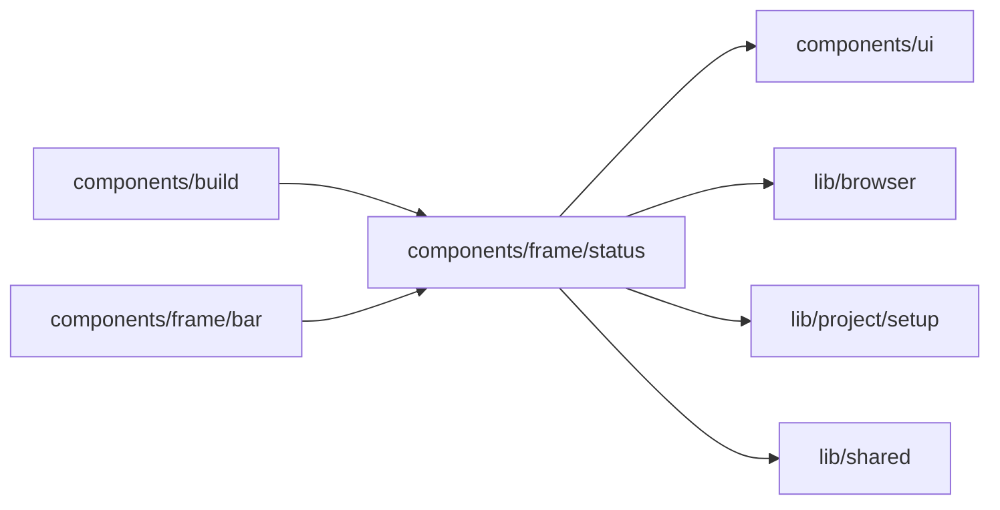

# Environment status

<!-- BEGIN GENERATED DIRECTORY SUMMARY (scripts/check-readmes.mjs; edit only Purpose) -->
Purpose: The bar's environment tabs: one status dot each, and a word only when something is off, which links to its fix or, for a stopped Preview, opens Start.

Importers: `components/build` and `components/frame/bar` import this directory.

Imports: it imports `components/ui`, `lib/browser`, `lib/project/setup` and `lib/shared`.

<!-- END GENERATED DIRECTORY SUMMARY -->

The statuses are the closed sets of `lib/project/setup/environment-status.ts`, each with its tone, its word or none, and where its fix is; the tab only draws one. A healthy environment's dot is its own colour, grey for Preview and green for Live.
