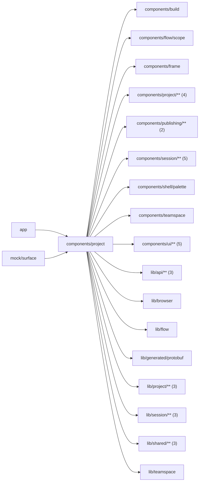

# Project pages

<!-- BEGIN GENERATED DIRECTORY SUMMARY (scripts/check-readmes.mjs; edit only Purpose) -->
Purpose: The Project pages: the start form, Project creation, Project details, the Project's one Session provider, the surfaces and tools inside the Builder frame, and Setup on either tab.

Importers: `app` and `mock/surface` import this directory.

Imports: it imports `components/build`, `components/flow/scope`, `components/frame`, `components/project/**` (4), `components/publishing/**` (2), `components/session/**` (5), `components/shell/palette`, `components/teamspace`, `components/ui/**` (5), `lib/api/**` (3), `lib/browser`, `lib/flow`, `lib/generated/protobuf`, `lib/project/**` (3), `lib/session/**` (3), `lib/shared/**` (3) and `lib/teamspace`.

<!-- END GENERATED DIRECTORY SUMMARY -->

ProjectStartForm asks what process Dex should run: the description becomes the
first message, and under it `templates/` ranks the server's built examples by the
description. Open example creates the Project from one as it is, for either agent,
with the example and no message; the description waits in the opened Project's
composer as an unsent draft. A placeholder fills the composer without sending. The
Project name comes from the description, a placeholder or the opened example's
title; Advanced lets the user edit it.
Agent is chosen first; only the Superverse agent offers a model, preselected on
Sonnet or the mock model where the server permits it. The mock composer takes
the first input of a scenario in place of free text when that model is chosen.
ProjectCreationPage admits the managed source with a stable request ID and
marks the Project's first conversation in this browser before opening the Builder.
The Superverse path includes its first message and model in CreateProject.
The local path retains its message in ProjectIntent, watches Project READY and
Session ACTIVE, shows inline pairing, and sends after the Snapshot reports
remote authority. A creation from an example sends no message on either path:
it writes the draft as the new Project's composer draft, and the local path
opens the Project once the agent holds the Session. An example Project has its
card at once, so it skips the chat-only first conversation. ProjectBuilder follows the Project's stage (`lib/project/stage`): the chat
alone until the first draft of the agent's first requirements card or the agent's own processes, or until
the person picks "Open the Flow tab" in its bar when no card comes, then the standard frame, whose tabs, Publish and Preview's status appear as they have something
to show. ProjectPage is the Project's
details: its status, repository, links into the Builder, the Preview's automatic
builds (read from the Project's Session, for those who build) and deletion. Storage errors
and aborted or stale responses retain their existing handling. Deletion always cleans
owned resources and archives the managed repository.

ProjectSurface puts the Project into the Builder frame (`components/frame`): the
Session's chat in the chat column and, for the surface the URL names, the Flow,
Runs, Inbox, Interface or the open tool (ProjectToolContent). Preview Runs and
Inbox read the running Preview; Live ones read the Release Live serves.
