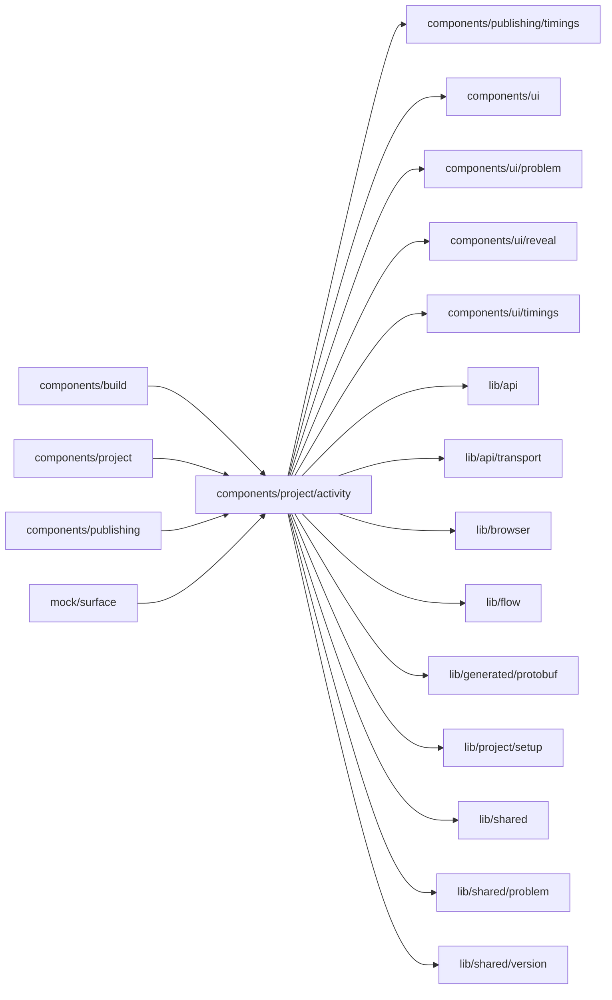

# components/project/activity

<!-- BEGIN GENERATED DIRECTORY SUMMARY (scripts/check-readmes.mjs; edit only Purpose) -->
Purpose: The per-environment timeline and the recent trigger events: Preview's starts, Live's publishes and deployments, each with version, outcome and problem.

Importers: `components/build`, `components/project`, `components/publishing` and `mock/surface` import this directory.

Imports: it imports `components/publishing/timings`, `components/ui`, `components/ui/problem`, `components/ui/reveal`, `components/ui/timings`, `lib/api`, `lib/api/transport`, `lib/browser`, `lib/flow`, `lib/generated/protobuf`, `lib/project/setup`, `lib/shared`, `lib/shared/problem` and `lib/shared/version`.

<!-- END GENERATED DIRECTORY SUMMARY -->
