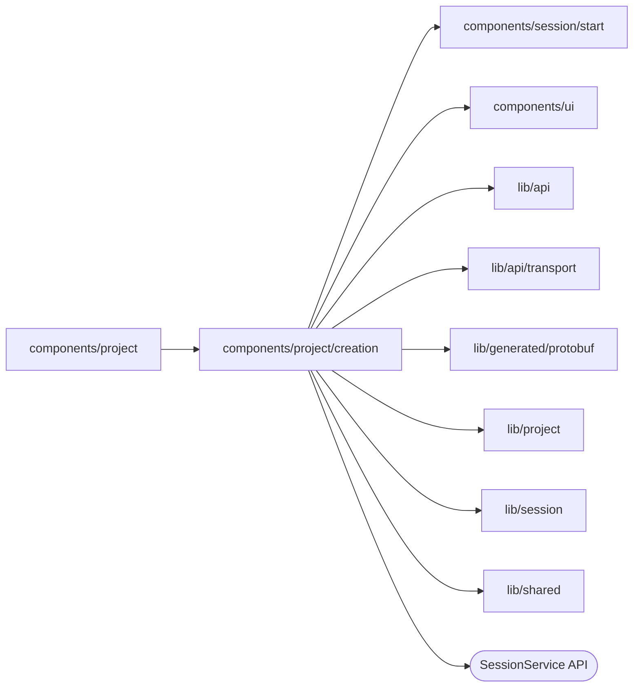

# Local Project creation

<!-- BEGIN GENERATED DIRECTORY SUMMARY (scripts/check-readmes.mjs; edit only Purpose) -->
Purpose: Watches a newly created Project and Session, then shows inline pairing until the chosen local agent activates.

Importers: `components/project` imports this directory.

Imports: it imports `components/session/start`, `components/ui`, `lib/api`, `lib/api/transport`, `lib/generated/protobuf`, `lib/project`, `lib/session` and `lib/shared` and calls the `SessionService` API.

<!-- END GENERATED DIRECTORY SUMMARY -->

The Project Watch gates Session reads. The Session Watch supplies canonical
executor authority; an ACTIVE Session alone does not send the first message. An
example opened for a local agent has no first message: the Project opens once the
agent holds the Session.
The inline card shows the warning, ten-minute code, endpoint command and
waiting state. Expiry requests a fresh code without losing ProjectIntent.
Before SendMessage, Studio persists a sending marker because the RPC does not
deduplicate message IDs. A lost response is never retried automatically; the
person can inspect the original message and Project conversation.
