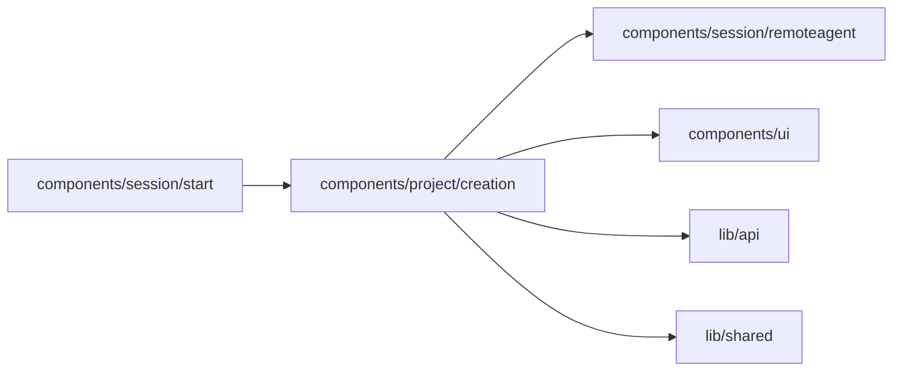

# Local Project creation

<!-- BEGIN GENERATED DIRECTORY SUMMARY (scripts/check-readmes.mjs; edit only Purpose) -->
Purpose: Connects a local agent using inline risk acknowledgement and an expiring pairing code.

Importers: `components/session/start` imports this directory.

Imports: it imports `components/session/remoteagent`, `components/ui`, `lib/api` and `lib/shared`.

<!-- END GENERATED DIRECTORY SUMMARY -->

Creation opens the accepted Project immediately. Creation never waits for
pairing or sends a message to the platform agent. The Project chat owns inline
connection instructions, the editable browser draft and its remote-only send.
