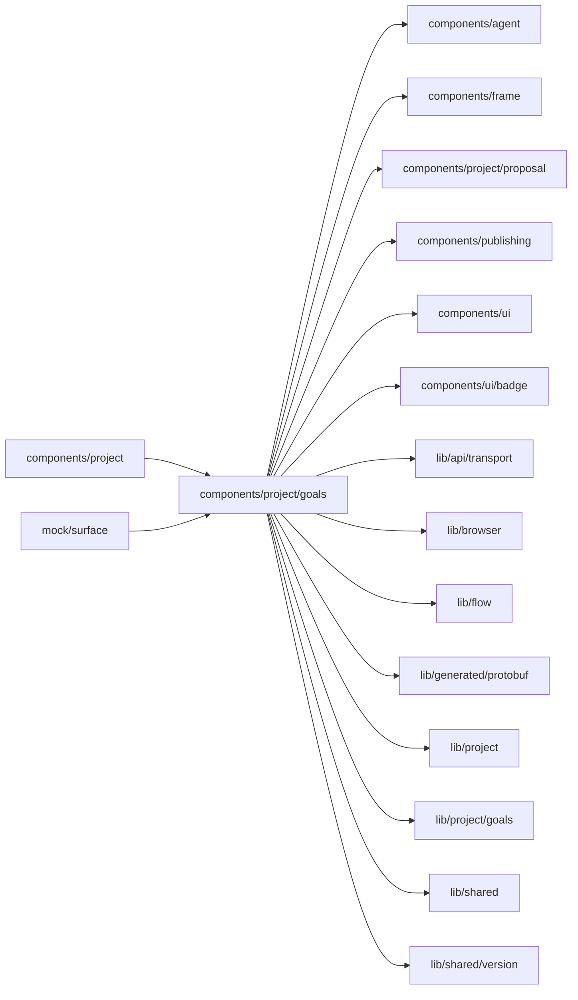

# Goals surface

<!-- BEGIN GENERATED DIRECTORY SUMMARY (scripts/check-readmes.mjs; edit only Purpose) -->
Purpose: The Builder's Goals tab: the Live version's goals with their values and trends, the agent's proposals, the reviews that measured them, Review now and Set goals.

Importers: `components/project` and `mock/surface` import this directory.

Imports: it imports `components/agent`, `components/frame`, `components/project/proposal`, `components/publishing`, `components/ui`, `components/ui/badge`, `lib/api/transport`, `lib/browser`, `lib/flow`, `lib/generated/protobuf`, `lib/project`, `lib/project/goals`, `lib/shared` and `lib/shared/version`.

<!-- END GENERATED DIRECTORY SUMMARY -->

`GoalsSurface` shows the Project's goal measurement, which the Builder reads once for the tab, its mark and the chat's
proposal card (`lib/project/goals`, `EvolveProvider`, `EvolveService.GetEvolve`); opening the tab reads it again. Before
the first Live deployment the server answers NOT_FOUND, which shows, like a Live version without goals, the empty state
with **Set goals**: it hands the chat "Help me set goals for this app" through the Builder's `askAgent`
(`ComposerDraftProvider.propose`, the way Step and run actions ask the agent), so only those who build see it. An
invalid goals file shows the parser's problems by line, says that reviews wait for a fixed and published file, and
offers **Fix with the agent**. The goals, the proposals and the reviews show on Live; on Preview one line says goals are
measured on Live runs and that changes to the goals file take effect when published, with a link to Live, and the empty
state on Preview adds that only Live runs count and the goals file takes effect when published. Preview and test runs
never feed a goal value (Live published runs only, owner rule 2026-10-22). When a later Live version has no goals while
the agent's proposals remain, the tab keeps them, under a Goals box that says there are none with **Set goals**, so the
chat card's **Details**, the tab's mark and a decision always have the proposal's row.

`GoalRows` draws one row per goal: the statement, the kind, the direction or the guardrail's limit with whether it
holds (an icon and the value's colour), the target, the runs the value rests on with a "few runs" mark under 20, the
value of the newest measured review in its metric's unit (shares as percentages, `ai.usd` in dollars, hours,
plain numbers) and a small line of its values over the measured reviews when at least two measured it.
`GoalReviews` lists the kept reviews, newest first, with Publishing's history rows: the status with its reason in
words (`review-words.ts`, which also names an agent review's statuses: reviewing, proposed a change, no change and
expired), what started it, the runs it read and their window, and a failed review's cause folded
underneath. **Review now** (`StartEvolveReview`, only for those who build) sends a Studio request ID that a retry
after an unknown outcome repeats; a running review, an invalid goals file and the once-a-day limit hold it back, and a
refusal shows in words beside it. While a review runs the measurement is read again until it ends.

`GoalProposals` lists the agent's proposals between the goals and the reviews, newest first, with the same history rows:
the title, which wraps whole, a status badge, which a narrow row moves under the title (`HistoryRow`'s `trailing`),
and when the review proposed it. Nothing shows before the first proposal. A row opens to the
summary; each goal before and after the change as the backtest replayed the review's runs (`ProposalBacktest`, in the
goal rows' style through `GoalRows`' `goalKindFacts` and `GoalFacts`): the value before over the runs the after value
covers, the after value with its interval when estimated, how many runs it knows, estimates and leaves unknown, the
targeted goal, and a better or worse colour with its check or alert only when the whole interval moves; the runs by
how the backtest knows them with their shares and its calibration; and Why, What changes, Open runs, Risks and Undo from the agent's document
(`GetEvolveProposal`, read when the row first opens, drawn with the chat's `MarkdownContent`, its headings at the row's
own level). An offered proposal ends in the amber "Approval required" footer with Approve and Decline, a decided one in
where it went, from `components/project/proposal`; after a decision the focus moves to that line, which reads it out.
Those who only operate see who decides an offered proposal instead of the footer. A row's `#proposal-<review>` anchor,
which the chat card's Details links to, opens the row, scrolls to it and focuses it (`useAnchorRequests`), from the URL's hash once the list shows
or from the link's jump (`focusAnchor`). A live proposal's Undo opens Tools ▸ Publishing at
the release Live ran just before it went live, which the measurement records (`previousLiveReleaseId`).
