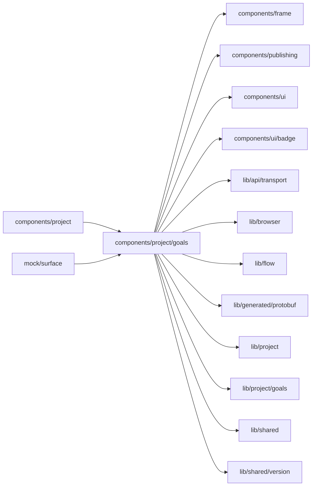

# Goals surface

<!-- BEGIN GENERATED DIRECTORY SUMMARY (scripts/check-readmes.mjs; edit only Purpose) -->
Purpose: The Builder's Goals tab: the goals of the Live version with their values and trends, the reviews that measured them, Review now and Set goals.

Importers: `components/project` and `mock/surface` import this directory.

Imports: it imports `components/frame`, `components/publishing`, `components/ui`, `components/ui/badge`, `lib/api/transport`, `lib/browser`, `lib/flow`, `lib/generated/protobuf`, `lib/project`, `lib/project/goals`, `lib/shared` and `lib/shared/version`.

<!-- END GENERATED DIRECTORY SUMMARY -->

`GoalsSurface` reads the Project's goal measurement (`lib/project/goals`, `EvolveService.GetEvolve`). Before the
first Live deployment the server answers NOT_FOUND, which shows, like a Live version without goals, the empty state
with **Set goals**: it hands the chat "Help me set goals for this app" through the Builder's `askAgent`
(`ComposerDraftProvider.propose`, the way Step and run actions ask the agent), so only those who build see it. An
invalid goals file shows the parser's problems by line, says that reviews wait for a fixed and published file, and
offers **Fix with the agent**. The goals and their reviews show on Live; on Preview one line says goals are measured
on Live runs and that changes to the goals file take effect when published, with a link to Live, and the empty state
on Preview adds that only Live runs count and the goals file takes effect when published. Preview and test runs never
feed a goal value (Live published runs only, owner rule 2026-10-22).

`GoalRows` draws one row per goal: the statement, the kind, the direction or the guardrail's limit with whether it
holds (an icon and the value's colour), the target, the runs the value rests on with a "few runs" mark under 20, the
value of the newest measured review in its metric's unit (shares as percentages, `ai.usd` in dollars, hours,
plain numbers) and a small line of its values over the measured reviews when at least two measured it.
`GoalReviews` lists the kept reviews, newest first, with Publishing's history rows: the status with its reason in
words (`review-words.ts`), what started it, the runs it read and their window, and a failed review's cause folded
underneath. **Review now** (`StartEvolveReview`, only for those who build) sends a Studio request ID that a retry
after an unknown outcome repeats; a running review, an invalid goals file and the once-a-day limit hold it back, and a
refusal shows in words beside it. While a review runs the measurement is read again until it ends.
