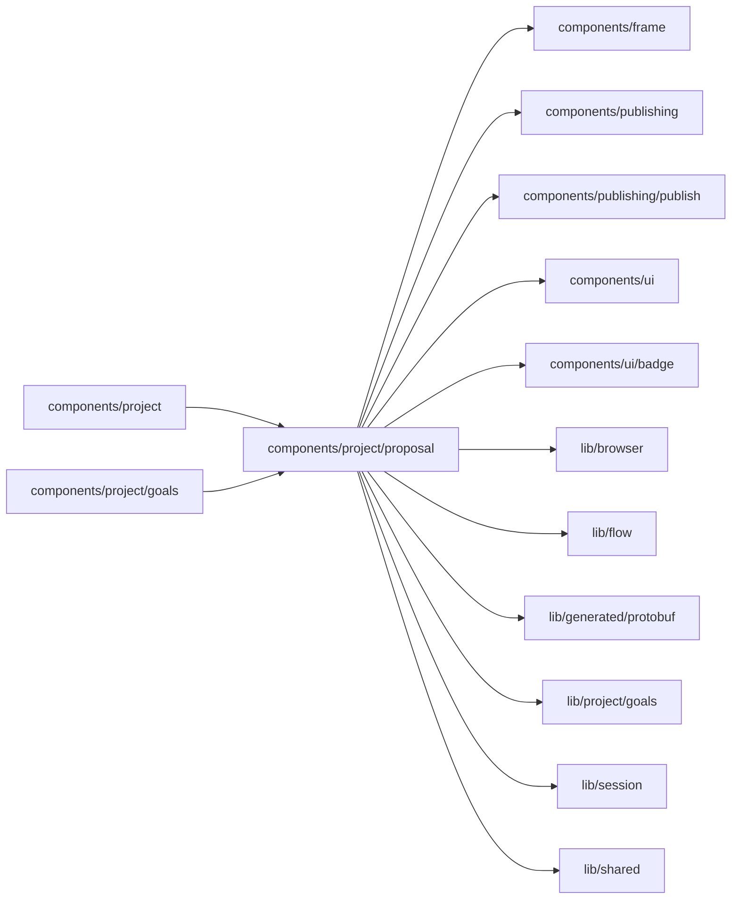

# Agent proposal cards

<!-- BEGIN GENERATED DIRECTORY SUMMARY (scripts/check-readmes.mjs; edit only Purpose) -->
Purpose: The agent's proposal as the chat's card and the Goals tab's decision footer: Approve, Decline with a reason, and where it goes until it ships.

Importers: `components/project` and `components/project/goals` import this directory.

Imports: it imports `components/frame`, `components/publishing`, `components/publishing/publish`, `components/ui`, `components/ui/badge`, `lib/browser`, `lib/flow`, `lib/generated/protobuf`, `lib/project/goals`, `lib/session` and `lib/shared`.

<!-- END GENERATED DIRECTORY SUMMARY -->

The platform agent proposes one change to a Live app per review; a person who builds approves or declines it. Two cards
show the same proposal, and both act on it the same way.

`ProposalChat` is the Builder's orchestration of the chat's card. From the Builder's one read of the goal measurement
(`lib/project/goals`, `EvolveProvider`) it picks the offered proposal, or else the newest one that waits to ship
(approved or applied) or whose decision the agent did not get (approved or declined, which a person tells it), and
hands `ProposalDockCard` its goals, controls and links. A decision the server refused because the proposal changed keeps
that proposal in the card instead, with where it went and "This proposal changed since you opened it.", until the
proposal moves on, the next decision or the person folds it. The card itself fetches nothing: it shows "Proposal", the
title, the summary (whole while it waits for a decision, so its risks show beside Approve, then in one line), the
goals the backtest moves (the targeted goal first, then every goal that gets worse, which is never
left out, then others up to three; an estimated value as "about"; the after value green when better and red when worse,
by the review's direction, with a check or an alert beside it so the colour is never the only sign, `GoalAfterValue`),
Approve and Decline while it is offered, then where it is, and **Details**, which jumps to the proposal's row on Live's
Goals tab (`#proposal-<review>`, `focusAnchor`), opening and focusing it. It folds to one line and never blocks the
composer, and its rows shrink with a narrow chat, cutting the goal's statement before its values; the Builder passes it
to the chat as its `dock` slot. A goal Live's goals file no longer has reads "<its ID>: a goal no longer in the goals
file", so two such goals never read alike.

After a decision, `use-decision-focus.ts` moves the focus on purpose: once the proposal is read again out of offered,
to the card's state line, which reads where it went; when the chat's card leaves instead, to the composer, or, when the
composer cannot take it (it waits for a model key, or a request runs), to the chat's heading (`CHAT_HEADING_ID`),
while a live region that `ProposalChat` keeps in the chat says where the proposal went. A refusal or a failed approval
shows in both cards (`DecisionNote`), and only the card that sent the decision announces it, so each outcome is heard
once.

`use-proposal-controls.ts` builds what a card can do, for both cards: Approve and Decline through the Builder's shared
`DecideEvolveProposal` at the revision the card rendered, after which the measurement is read again for every card, so
the two never disagree; a refusal or a failure shows only while the proposal stays at the revision the answer found;
**Tell the agent**, which puts a decision the agent did not get into the composer (`askAgent`) and has the Builder read
the measurement until the agent carries it out, or, for an expired proposal, asks the agent to redo it; **Publish…**,
which opens the bar's Publish popover on the applied commit (`openPublishPopover`) or, when it does not open (no Publish
on the bar, or a publish runs), Tools ▸ Publishing; and **Undo…**, Tools ▸ Publishing at the release Live ran just
before the proposal went live, which the measurement records (`previousLiveReleaseId`, `releaseHref`), or at Publishing
without a release when it recorded none, as for older records; both cards take the same rule from the Builder's frame
links. Operators get none of the actions, and no instruction they cannot follow.

`ProposalDecision.tsx` draws Approve and Decline (`DecisionButtons`), the Goals tab's amber "Approval required" footer
with what approving does (`ProposalApproval`), a refusal because the proposal changed since the page showed it or a
failed approval (`DecisionNote`), and each later state in plain words (`ProposalState`): for those who build, what to do
next (tell the agent, publish, undo, or ask the agent again for an expired proposal); for those who only read, where it
is ("Waiting for one of the app's builders to approve or decline it.", "Approved; the agent hasn't been told yet.", "On
Preview, waiting to be published."). `DeclineDialog` is Decline's one dialog, with an optional reason of at most 500
characters that later reviews read; the reason's hint describes the text box and turns into its error, which is
announced once, when the reason is too long. `proposal-words.ts` holds the status badges, the words of each state and a
goal's better or worse; an undone proposal says whether a rollback of Live undid it or an undo proposal that went Live.
