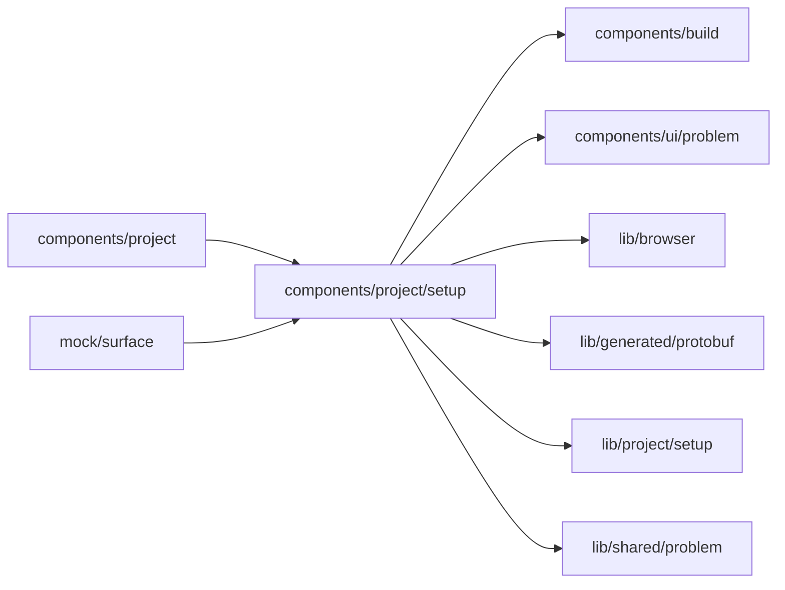

# Setup components

<!-- BEGIN GENERATED DIRECTORY SUMMARY (scripts/check-readmes.mjs; edit only Purpose) -->
Purpose: Setup's pieces above the table: the bar with Preview's line and the Next publish line, and the Live tab's banner.

Importers: `components/project` and `mock/surface` import this directory.

Imports: it imports `components/build`, `components/ui/problem`, `lib/browser`, `lib/generated/protobuf`, `lib/project/setup` and `lib/shared/problem`.

<!-- END GENERATED DIRECTORY SUMMARY -->

`SetupStatus.tsx` holds each column's state, which Setup's table draws under the column's name: what Preview
lacks, the changes it is being updated with or what it runs; what the next publish needs, waits for or is
ready to publish; each missing item is a link that opens and focuses it. Before the latest push is built it
says why the table is not shown yet. Setup has no Apply or Publish button: `auto-apply.ts` applies Preview's
saved changes on its own once edits settle, one apply per burst, never twice for one configuration and
Preview revision, and never while a push's update runs; the bar's Publish publishes.
`LiveBanner.tsx` is the Live tab's dark banner: that these are Live's settings and the version Live runs.
What waits for a publish is the state under Live's name.
