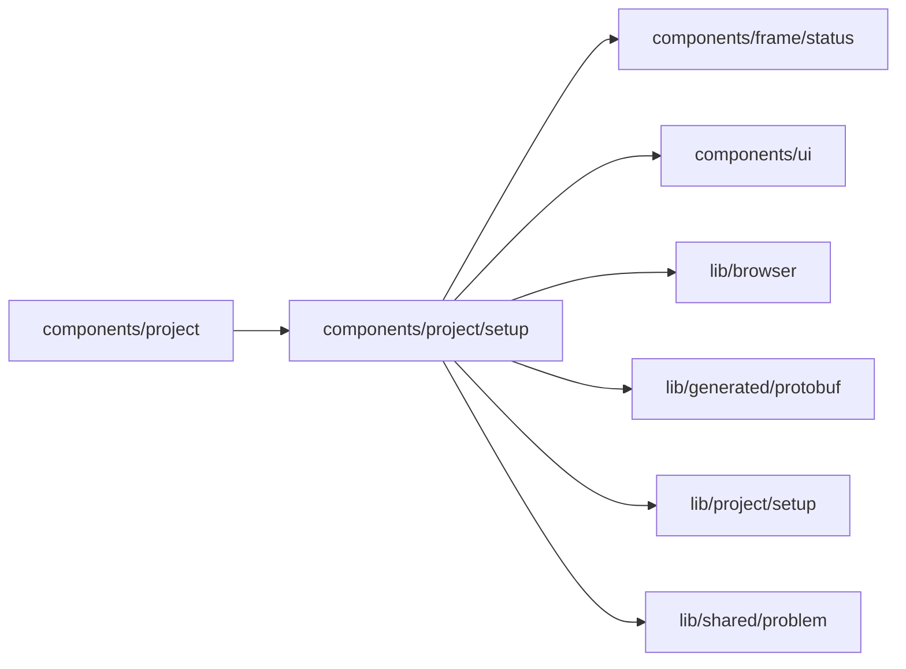

# Setup components

<!-- BEGIN GENERATED DIRECTORY SUMMARY (scripts/check-readmes.mjs; edit only Purpose) -->
Purpose: Setup's pieces above the table: the bar with Preview's line and the Next publish line, and the Live tab's banner.

Importers: `components/project` imports this directory.

Imports: it imports `components/frame/status`, `components/ui`, `lib/browser`, `lib/generated/protobuf`, `lib/project/setup` and `lib/shared/problem`.

<!-- END GENERATED DIRECTORY SUMMARY -->

`SetupBar.tsx` says what Preview lacks or does not run yet, with Apply to Preview, and what the next
publish needs, waits for or is ready to publish; each missing item is a link that opens and focuses it.
`LiveBanner.tsx` is the Live tab's dark banner: the version Live runs, what waits for a publish and the way
to publish it. Both publish through the bar's Publish popover (`components/publishing/publish`,
`openPublishPopover`): the Next publish line's "Publish…" on the newest version, the banner's "Publish this
change…" on Live's own version with its waiting settings.
