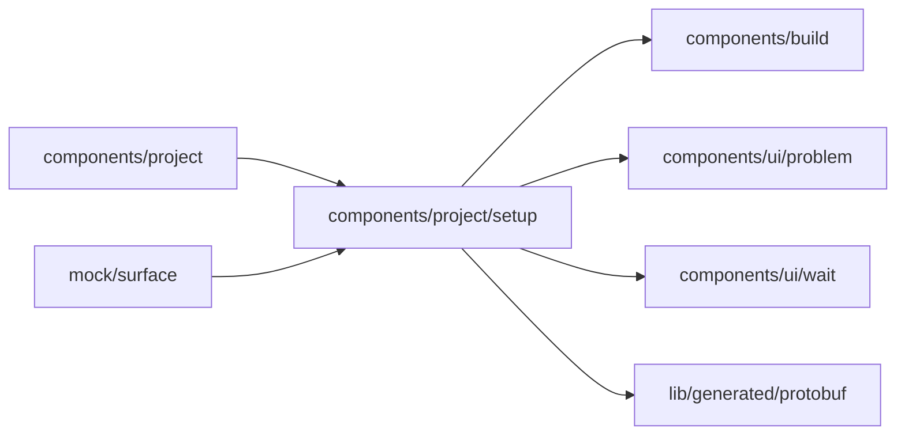

# Setup components

<!-- BEGIN GENERATED DIRECTORY SUMMARY (scripts/check-readmes.mjs; edit only Purpose) -->
Purpose: Setup's pieces around the table: why it is not shown yet, the automatic apply of Preview's saved changes, and the Live tab's banner.

Importers: `components/project` and `mock/surface` import this directory.

Imports: it imports `components/build`, `components/ui/problem`, `components/ui/wait` and `lib/generated/protobuf`.

<!-- END GENERATED DIRECTORY SUMMARY -->

`SetupStatus.tsx` says why the table is not shown yet, before the latest push is built. The table's head
names its columns only: each row's colours say what a column lacks, the bar's Preview status leads to the
first missing item, and the Publish popover says what the next publish needs. Setup has no Apply or Publish
button: `auto-apply.ts` applies Preview's saved changes on its own once edits settle, one apply per burst,
never twice for one configuration and Preview revision, and never while a push's update runs; the bar's
Publish publishes. `LiveBanner.tsx` is the Live tab's dark banner: that these are Live's settings and the
version Live runs.
