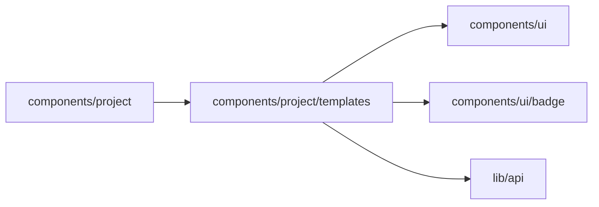

# Start templates

<!-- BEGIN GENERATED DIRECTORY SUMMARY (scripts/check-readmes.mjs; edit only Purpose) -->
Purpose: The start page's starting points: the server's built examples and the placeholder templates, their gallery, the suggestions while typing, and the Project name a description gives.

Importers: `components/project` imports this directory.

Imports: it imports `components/ui`, `components/ui/badge` and `lib/api`.

<!-- END GENERATED DIRECTORY SUMMARY -->

`template-catalog.ts` declares every placeholder once: its title, category, apps, who decides and a full
description that names the trigger, the people, the rules and the exceptions. Picking a placeholder only
fills the composer with its description, which the person reads and changes before sending.

Built examples are the examples of the server's application template (`ExampleService.ListExamples`, read
once per start page by `use-examples.ts`), listed on every model, including the mock model, whose scenario
composer hides the placeholders. `ExampleGrid.tsx` shows them under the composer:

- **Before the person types**, a starter set: at most two of each category, built examples first, then the
  placeholders, which are quieter (dashed, "Fill in this description").
- **While they type**, "Closest to your description": the six built examples the description matches best,
  the first marked Closest. `use-settled-text.ts` takes the description at once when a word ends and
  otherwise after 250 ms without typing, so the grid moves at word boundaries and not on every character;
  `use-card-motion.ts` moves each card from its old place to its new one (none under
  prefers-reduced-motion).
- **Browse all examples** opens `ExampleBrowser.tsx`: a search over the whole catalog with category and app
  filters.

`ExampleCard.tsx` gives a built example one action, Open example, which creates the Project from the
example as it is and opens it in one click. The creation carries the example and no message; what the
person typed waits in the opened Project's chat composer as an unsent draft.

`example-match.ts` matches in the browser, with no request. It indexes the catalog once, term to examples,
so a ranking reads only the typed terms' postings, well under a millisecond for hundreds of examples. A
term is a word of three letters or more, not a stop word, with one ending cut ("approval" and "approve"
meet); it counts once per field it appears in, three times in the title or the apps and once in the
category, the decider or the description. Ties keep the catalog's order. `project-name.ts` derives the
Project's name from a description when no template names it.
