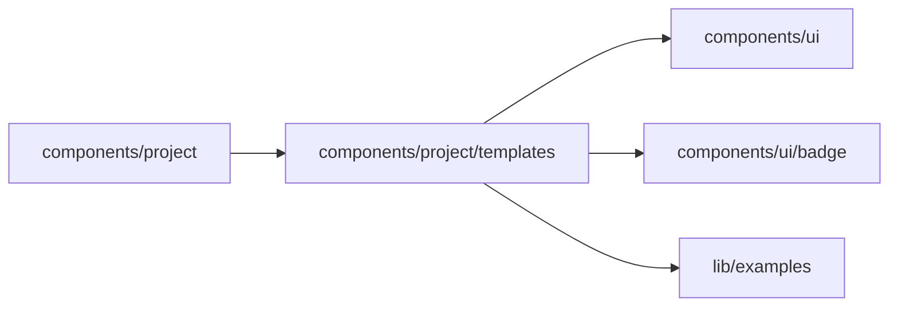

# Start templates

<!-- BEGIN GENERATED DIRECTORY SUMMARY (scripts/check-readmes.mjs; edit only Purpose) -->
Purpose: The start page's starting points: the bundled built examples and the placeholder templates, their gallery, the suggestions while typing, and the Project name a description gives.

Importers: `components/project` imports this directory.

Imports: it imports `components/ui`, `components/ui/badge` and `lib/examples`.

<!-- END GENERATED DIRECTORY SUMMARY -->

`template-catalog.ts` declares every placeholder once: its title, category, apps, who decides and a full
description that names the trigger, the people, the rules and the exceptions. Picking a placeholder only
fills the composer with its description, which the person reads and changes before sending. Each
placeholder is also a labelled request of `app-template/examples/labelled-requests.json` that starts from the
default, which `scripts/check-example-search.mjs` checks.

Built examples are the examples of the application template Studio bundles (`BUILT_EXAMPLES`, from
[`lib/examples`](../../../lib/examples/README.md)), listed on every model, including the mock model, whose
scenario composer hides the placeholders. `ExampleGrid.tsx` shows them under the composer:

- **Before the person types**, a starter set: at most two of each category, built examples first, then the
  placeholders, which are quieter (dashed, "Fill in this description").
- **While they type**, "Closest to your description": the six built examples the description matches best,
  the first marked Closest. `use-settled-text.ts` takes the description at once when a word ends and
  otherwise after 250 ms without typing, so the grid moves at word boundaries and not on every character;
  `use-card-motion.ts` moves each card from its old place to its new one (none under
  prefers-reduced-motion).
- **Browse all examples** opens `ExampleBrowser.tsx`: a search over the whole catalog with category and app
  filters.

`ExampleCard.tsx` gives a built example one action, Open example, which creates the Project from the
example as it is and opens it in one click. The creation carries the example and no message; what the
person typed waits in the opened Project's chat composer as an unsent draft.

`example-match.ts` ranks with the example search of `lib/examples`, the one the server shortlists with, in the
browser and with no request: rare words count more (BM25), the title and the apps count most, synonyms such as
sign off for approve meet, and ties keep the catalog's order. `project-name.ts` derives the Project's name from
a description when no template names it.
