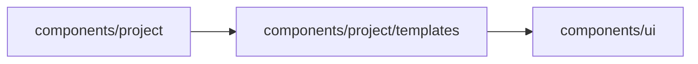

# Start templates

<!-- BEGIN GENERATED DIRECTORY SUMMARY (scripts/check-readmes.mjs; edit only Purpose) -->
Purpose: The start page's process templates: their typed catalog, the gallery that fills the composer with one, and the Project name a description gives.

Importers: `components/project` imports this directory.

Imports: it imports `components/ui`.

<!-- END GENERATED DIRECTORY SUMMARY -->

`template-catalog.ts` declares every template once: its title, category, apps, who decides and a full
description that names the trigger, the people, the rules and the exceptions. All are placeholders for
now: picking one only fills the composer with its description, which the person reads and changes before
sending. `project-name.ts` derives the Project's name from a description when no template names it.
