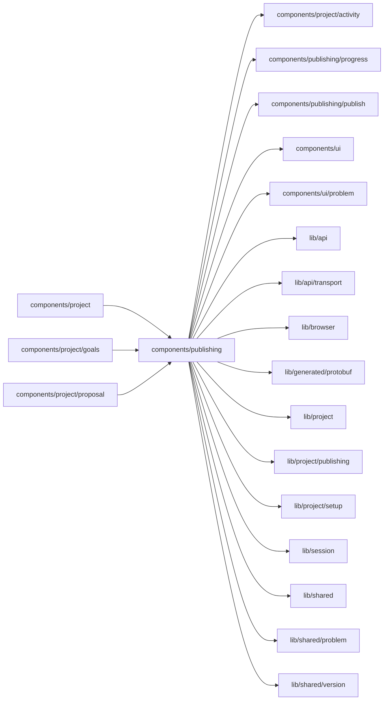

# Publishing surface

<!-- BEGIN GENERATED DIRECTORY SUMMARY (scripts/check-readmes.mjs; edit only Purpose) -->
Purpose: Tools, Publishing: the publish in progress, what is Live with Stop Live, every version with its builds, rollback after its consequences, and Live's history.

Importers: `components/project`, `components/project/goals` and `components/project/proposal` import this directory.

Imports: it imports `components/project/activity`, `components/publishing/progress`, `components/publishing/publish`, `components/ui`, `components/ui/problem`, `lib/api`, `lib/api/transport`, `lib/browser`, `lib/generated/protobuf`, `lib/project`, `lib/project/publishing`, `lib/project/setup`, `lib/session`, `lib/shared`, `lib/shared/problem` and `lib/shared/version`.

<!-- END GENERATED DIRECTORY SUMMARY -->

`PublishingPanel` shows, top to bottom: the publish in progress or the last one (`progress/`, with the
stage bar, Cancel and the inline log; the URL's `?release=&build=` or `?deployment=` names a publish just
started), what is Live and **Stop Live…** (`LiveDeployment`, `RemoveLive` after its
consequences; the Interface opens Live's address), the versions newest first, Preview's and Live's marked,
with the selected one's builds and, for a version older than Live, its rollback (`VersionDetail`), and Live's history (`LiveHistory`, `ListEnvironmentEvents` for Live, cancelled publishes
included). Builds and Live's history share `HistoryRows`: one line per row, opening underneath to the rest; a row with a `trailing`
part, such as a status badge, wraps its text whole instead of cutting it, and the trailing part, never cut, moves under the
text when both do not fit.
The bar's Publish publishes (`publish/`); there is no Publish here. An older version than Live rolls Live
back (`ReleaseDeployment`, `StartDeployment` of its last READY build after a
confirmation that names the version, its frozen settings, the runs in flight and that Preview and the
next publish stay as they are). Stop Live and rollback wait while a publish runs.
